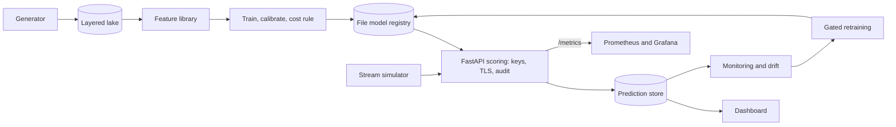

# Mobile Money Transaction Risk Intelligence Platform

An **M-Pesa-inspired** mobile-money transaction risk scoring platform, built as a local-first, near-zero-cost portfolio project.

> **Disclaimer.** This is an independent simulation. It is **not affiliated with, endorsed by, or connected to Safaricom or M-Pesa**. It uses **entirely synthetic data**. No real customer or transaction data is requested, scraped, or used. Metrics on synthetic data demonstrate engineering capability, not real-world fraud-detection performance.

**Status:** Phases 0 to 28 complete (see [roadmap](docs/roadmap.md)). CI is green: lint, the full test suite, Docker image builds, Terraform `validate`. What was checked where, and what was not, is in [docs/verification-status.md](docs/verification-status.md); known limits are in [docs/limitations.md](docs/limitations.md). Every doc is listed in [docs/index.md](docs/index.md). To see it run: [demo scripts](docs/demo.md) (`.\scripts\dev.ps1 demo`). What each area has actually been checked by, level by level: [evidence scorecard](docs/scorecard.md).

## Business problem
Mobile-money providers must stop fraud (SIM-swap, social engineering, mule accounts, agent cash-out) without blocking legitimate customers. The platform outputs a risk **score** (probability) and a LOW / MEDIUM / HIGH level with an explanation. It never claims certainty. Thresholds come from an explicit cost model (false-positive friction vs missed-fraud loss).

## What it does
A synthetic data generator with delayed, noisy labels; a layered data lake with quarantine and data-quality checks; point-in-time-safe features (28, one library for training and serving); model comparison (rules, logistic regression, random forest, LightGBM) on a leak-safe time split; Platt calibration and an expected-cost rule that turns a probability into ALLOW, REVIEW or BLOCK; exact tree explanations and a model card; MLflow tracking; a FastAPI scoring service with API keys, TLS, rate limits and an audit log; an event-stream simulator; Prometheus and Grafana monitoring, drift detection and gated retraining over a file model registry; a read-only Streamlit dashboard; load testing; a hardened production-like Docker Compose deployment with backup and restore; and an AWS design with plan-only Terraform and a cost estimator. Nothing runs in the cloud.

## Results at a glance
Synthetic data, seed 42, test window 2025-10-02 to 2025-11-16 (24,224 transactions, 107 fraud-labelled, 0.44%). Source: [model card](docs/model-card.md), generated from the saved results.

| Scorer | Test PR-AUC | Cost per 10,000 transactions (ASSUMED costs, KES) |
|---|---|---|
| Random scorer | 0.004 | n/a |
| Hand-written rules | 0.161 | 61,519 |
| Logistic regression | 0.515 | 39,397 |
| Random forest | 0.552 | 44,045 |
| LightGBM (shipped) | 0.502 | 37,935 |

How to read this: with 107 frauds the intervals are wide and the three trained models are **not** separable; LightGBM is shipped for its exact explanations and missing-history handling, not for rank. Allowing everything costs 70,126 under the assumed costs, so the policy is 46% lower, which is a statement about the assumptions, not about money. Latency and load figures (one run each, 2 shared CPUs) are in [docs/load-testing.md](docs/load-testing.md). None of this says anything about real fraud.

## Architecture

Full diagram, data flow and the AWS mapping: [docs/architecture.md](docs/architecture.md).

## Stack (summary)
Python 3.12, Polars, DuckDB + Parquet, scikit-learn, LightGBM, SHAP, MLflow, FastAPI, Streamlit, Prometheus + Grafana, Docker Compose, pytest, ruff, GitHub Actions, Terraform (optional). Rationale: [docs/decisions.md](docs/decisions.md). (Evidently was replaced by a small tested PSI implementation; see [ADR-020](docs/adr/ADR-020-drift-detection.md).)

## Local setup (Windows PowerShell)
Run from the repository root. Requires Python 3.11+ and Git.
```powershell
.\scripts\dev.ps1 setup    # creates .venv and installs the project with dev, EDA and ML tools
.\scripts\dev.ps1 test     # runs pytest
.\scripts\dev.ps1 lint     # ruff check + format check
```
If script execution is blocked: `Set-ExecutionPolicy -Scope CurrentUser RemoteSigned`.
Linux/macOS: `make setup`, `make test`, `make lint`.

## Data generation
Reproducible, seeded, synthetic. Run from the repository root (after `.\scripts\dev.ps1 setup`):
```powershell
.\scripts\dev.ps1 generate
# or with options:
.\.venv\Scripts\python -m mmrisk.generation --num-customers 5000 --num-transactions 200000 `
  --fraud-rate 0.005 --seed 42 --start-date 2025-01-01 --end-date 2025-12-31 --output-dir data/raw
```
Writes Parquet tables, noisy delayed labels, hidden ground truth and `manifest.json` to `data/raw/` (git-ignored; regenerate any time). Details: [data dictionary](docs/data-dictionary.md).

## Ingestion (data lake layers)
Builds raw, validated, quarantine and cleaned layers from the generated files. Safe to re-run: unchanged files are skipped.
```powershell
.\scripts\dev.ps1 ingest                       # data/raw -> data/processed
.\.venv\Scripts\python -m mmrisk.ingestion status   # ledger + consistency check
```
See [data dictionary](docs/data-dictionary.md#data-lake-layers-phase-3) and [ADR-008](docs/adr/ADR-008-layered-ingestion.md). Problems? [Troubleshooting](docs/troubleshooting.md).

## Data quality
Bad rows are quarantined with a reason during ingestion; a separate command checks the whole lake and reports PASS / WARN / FAIL.
```powershell
.\scripts\dev.ps1 quality                                  # show WARN / FAIL checks
.\.venv\Scripts\python -m mmrisk.validation check --verbose   # show every check
```
Rules, thresholds and "what happens when bad data enters the system?": [docs/data-quality.md](docs/data-quality.md).

## Exploratory data analysis
Seven figures, each answering a stated question, plus a Markdown report in which every number is computed from the lake (nothing is typed by hand). Label statistics use only transactions old enough to have final labels. A clearly marked optional section compares the observed labels with the hidden ground truth.
```powershell
.\scripts\dev.ps1 eda        # writes docs/eda-report.md and docs/figures/eda/*.png
.\.venv\Scripts\python -m mmrisk.eda --no-truth   # skip the ground-truth audit
```
Read the report: [docs/eda-report.md](docs/eda-report.md). Design: [ADR-010](docs/adr/ADR-010-eda-report-design.md).

## Features
One feature library, used for training now and for scoring later. Every feature uses only the transaction and strictly earlier history (no labels, no future rows), and the online path runs the same code as the batch path.
```powershell
.\scripts\dev.ps1 features                                # data/features/transaction_features.parquet
.\.venv\Scripts\python -m mmrisk.features audit            # leak-smell check on matured labels
.\.venv\Scripts\python -m mmrisk.features catalog          # regenerate docs/feature-catalog.md
```
28 features (velocity, baseline, novelty, inbound-transfer and time features): [feature catalog](docs/feature-catalog.md). Design and what was left out on purpose: [ADR-011](docs/adr/ADR-011-shared-point-in-time-features.md).

## Baseline models
A leak-safe time split (train, a 45-day label gap, validation, test), then three baselines scored on the same held-out period: hand-written rules, logistic regression and a random forest. The primary metric is PR-AUC (a random scorer scores the fraud rate); every metric has a 95% interval that resamples whole customers; the report also shows what a fixed review budget buys and how much a careless split would have inflated the scores.
```powershell
.\scripts\dev.ps1 train                                   # about 3 to 10 minutes; writes docs/model-baselines.md
.\.venv\Scripts\python -m mmrisk.models train --quick     # smaller grid, faster
```
Results and caveats: [docs/model-baselines.md](docs/model-baselines.md). Design: [ADR-012](docs/adr/ADR-012-time-split-and-evaluation.md). Trained models are written to `models/baselines/` (git-ignored). Results are on synthetic data and say nothing about real fraud.

## Advanced model and cost-based decisions
LightGBM is tuned on the validation window and compared with the baselines. Every scorer is calibrated (Platt scaling, fitted on validation only), then an expected-cost rule picks ALLOW, REVIEW or BLOCK (risk level LOW, MEDIUM, HIGH) from the probability and the amount. The costs are **assumptions**, reported with sensitivity tables, intervals and a comparison with a fixed 0.5 cut-off.
```powershell
.\scripts\dev.ps1 train          # Phase 7 baselines first (the advanced step reuses them)
.\scripts\dev.ps1 advanced       # writes docs/model-advanced.md and four figures
.\.venv\Scripts\python -m mmrisk.models advanced --quick --bootstrap 100   # faster
```
Results and caveats: [docs/model-advanced.md](docs/model-advanced.md). Assumptions: [docs/cost-model.md](docs/cost-model.md). Design: [ADR-013](docs/adr/ADR-013-calibration-and-cost-based-decisions.md). The decision bundle is written to `models/advanced/` (git-ignored). Synthetic data only; the savings say nothing about real money.

## Explanations and model card
Exact tree explanations (TreeSHAP) for the LightGBM model, cross-checked by shuffling features, by refitting without them, and by comparing two time windows. Reason codes for flagged transactions, a table of who gets flagged, and a model card whose numbers are read from the saved results. The report states where the measures disagree.
```powershell
.\scripts\dev.ps1 explain        # needs `advanced` first; about 2 to 6 minutes; writes docs/model-explanations.md
.\scripts\dev.ps1 card           # writes docs/model-card.md from the saved results
.\.venv\Scripts\python -m mmrisk.models explain --quick   # faster, fewer shuffles and one seed
```
Results: [docs/model-explanations.md](docs/model-explanations.md). Model card: [docs/model-card.md](docs/model-card.md). Design: [ADR-014](docs/adr/ADR-014-explanations-and-model-card.md). In code, `RiskModel.explain(df)` returns reason codes. Explanations describe the model, not causes; synthetic data only.

## One training command and experiment tracking
`python -m mmrisk.pipeline run` runs features, baselines, the advanced model, explanations and the model card in one process and records the run (data fingerprint, git commit, library versions, about 100 metrics, reports and the model bundle) in a local MLflow store. Nothing leaves the machine; a remote tracking address is refused.
```powershell
.\scripts\dev.ps1 pipeline        # full run; rewrites models/ and docs/ (not yet timed on a laptop; the quick run below took about 8 minutes on the author's 2-core laptop, so expect the full run to be longer)
.\.venv\Scripts\python -m mmrisk.pipeline run --quick --bootstrap 50   # about 1 minute in the sandbox, about 8 minutes on the author's laptop; writes to models\quick and docs\quick
.\scripts\dev.ps1 compare         # last runs: status, test PR-AUC, assumed cost, seconds, commit
.\.venv\Scripts\mlflow ui --backend-store-uri sqlite:///mlflow.db       # browse at http://127.0.0.1:5000
```
Use `--no-tracking` to skip MLflow. The full run overwrites the committed reports in `docs/`; quick runs do not. Design: [ADR-015](docs/adr/ADR-015-experiment-tracking-and-pipeline.md). The model registry comes in Phase 16.

## Scoring API (local)
A FastAPI service around the saved model and the same online feature code the batch path uses. It listens on 127.0.0.1 only and has no authentication; it is for this machine and synthetic data.
```powershell
.\scripts\dev.ps1 apicheck       # streams the last 300 transactions through the service and compares with batch scoring
.\scripts\dev.ps1 serve          # needs `advanced` (or `pipeline`) first; replays history, then listens on http://127.0.0.1:8000
```
Then open http://127.0.0.1:8000/docs to try `POST /v1/score`, or call it from PowerShell:
```powershell
$body = @{ transaction_id="TXN9000001"; customer_id="C000001"; timestamp="2026-01-05T09:30:00"; transaction_type="SEND_MONEY"; amount_kes=2500; counterparty_type="CUSTOMER"; counterparty_id="C000002"; device_id="D000001"; location_county="Nairobi"; channel="APP" } | ConvertTo-Json
Invoke-RestMethod -Method Post -Uri http://127.0.0.1:8000/v1/score -ContentType "application/json" -Body $body
```
The customer must exist in your data and the timestamp must be later than that customer's replayed history (use `--history-until` to replay only part of it). Design and limits: [ADR-016](docs/adr/ADR-016-local-scoring-api.md); threats: [threat model](docs/threat-model.md).

## Run the API in Docker
The same API in a locked-down container: read-only filesystem, no capabilities, a memory limit, a non-root user, published on 127.0.0.1 only. The image holds the code and its serving dependencies; your trained model and data lake are mounted read-only from the repo folder.
```powershell
.\scripts\dev.ps1 advanced     # once: creates models\advanced (or run `pipeline`); the lake must exist in data\processed
.\scripts\dev.ps1 up           # builds the image and starts it; the first build downloads the base image
# in a second window, once `docker compose ps` says "healthy" (the history is replayed first, allow a minute or two):
.\scripts\dev.ps1 smoke        # checks that cannot change the service's state
.\scripts\dev.ps1 down
```
Docs are at http://127.0.0.1:8000/docs. Before a first run on an 8 GB machine, cap WSL2's memory (see [troubleshooting](docs/troubleshooting.md)) and stop containers you do not need. CI builds this image and checks that it runs as a non-root user; the stricter production-like variant below was run on the author's Docker Desktop. Design and limits: [ADR-017](docs/adr/ADR-017-container-packaging.md).

## Streaming simulation
Replays stored transactions as a live feed through a bounded queue, with seeded delivery faults (late and reordered events, repeats, corrupted copies), a reorder buffer, and scoring either in process or through the running API. Predictions are appended to `data/predictions` (see [prediction store](docs/prediction-store.md)).
```powershell
.\scripts\dev.ps1 simulate      # last 7 days of the lake, in process, as fast as possible; needs models\advanced
.\scripts\dev.ps1 predictions   # summary of what was stored
# a messier run (jitter, repeats, corrupted copies), into a new folder:
.\.venv\Scripts\python -m mmrisk.streaming run --jitter-seconds 30 --max-lateness 60 --duplicate-rate 0.02 --bad-rate 0.01 --store data\predictions_messy
```
Through the API (start it with the history cut at the same time, then stream from there; restart the API before streaming the same events again):
```powershell
.\.venv\Scripts\python -m mmrisk.api serve --history-until 2025-12-24T23:55:49
.\.venv\Scripts\python -m mmrisk.streaming run --url http://127.0.0.1:8000 --from 2025-12-24T23:55:49
```
The run prints how every event ended (scored, rejected, dropped) and exits 1 if the books do not balance or the service failed. In Docker Compose: `$env:STREAM_FROM = "2025-12-24T00:00:00"; docker compose --profile simulate up --build` (create `data\predictions` first; TO VERIFY). Design and limits: [ADR-018](docs/adr/ADR-018-streaming-simulation.md).

## Monitoring
Two layers ([guide](docs/monitoring.md), [ADR-019](docs/adr/ADR-019-monitoring.md)). The API exposes Prometheus metrics at `/metrics` (requests, timings, decisions by action, probabilities; no identifiers). Prometheus and Grafana run as opt-in Compose services with a provisioned dashboard and seven alert rules. Separately, `python -m mmrisk.monitoring report` checks the stored predictions: consistency, gaps, freshness, review load and, against a frozen baseline, flagged share and volume.
```powershell
.\scripts\dev.ps1 simulate      # fill data\predictions
.\scripts\dev.ps1 baseline      # freeze it as the reference, if you judge it healthy
.\scripts\dev.ps1 monitor       # report in data\monitoring\report.md; exit code 1 only on FAIL
$env:GRAFANA_ADMIN_PASSWORD = "<choose one>"; .\scripts\dev.ps1 upmon   # Prometheus :9090, Grafana :3000 (TO VERIFY)
```
All thresholds are assumptions. These checks see decisions, not correctness (no labels) or input drift (Phase 15).

## Drift detection
Has the data the model sees moved away from what it was validated on? `python -m mmrisk.drift` summarises the validation window once (a few numbers per feature) and compares any later window with it using the population stability index, for the 28 features and for the model's score ([guide](docs/drift.md), [ADR-020](docs/adr/ADR-020-drift-detection.md)).
```powershell
.\scripts\dev.ps1 driftref      # data\drift\reference.json
.\scripts\dev.ps1 drift         # last 7 days against it; exit code 1 when drift is detected
.\.venv\Scripts\python -m mmrisk.drift report --scale-amounts 3   # demonstration of a detected shift
```
Calendar and accumulating features are handled explicitly, thresholds are conventions, and a rise of 50% in amounts goes unnoticed (measured). No drift does not mean the model is right.

## Gated retraining
Should the model be retrained, and is a new one safe? `python -m mmrisk.retrain check` looks at the drift report, the model's age and the number of new fraud labels; `run` trains a candidate on the newest data, scores it and the champion once on the same newest matured window, and applies gates (enough fraud, no overlap with the champion's training, PR-AUC and cost not worse beyond a margin, calibration, flagged share, reload check). The candidate is always saved in a file-based registry (`models/registry`); promotion is a separate, recorded step and rollback is one command ([guide](docs/retraining.md), [ADR-021](docs/adr/ADR-021-gated-retraining.md)).
```powershell
.\scripts\dev.ps1 regboot         # first model into the registry
.\scripts\dev.ps1 retrain-check   # exit 1 = retrain recommended
.\scripts\dev.ps1 retrain         # candidate + gates; exit 1 = rejected
.\.venv\Scripts\python -m mmrisk.registry promote v0002 --reason "gates passed, report reviewed"
```
Every threshold is an assumption. On the generated data the 45-day test window holds about a hundred frauds, so the gates cannot see differences smaller than about 0.03 PR-AUC (measured, ADR-021).

## Dashboard
A local, read-only Streamlit page over the files the earlier phases write: overview of the prediction store, a review queue with reason codes, the monitoring and drift status, and the model registry with each version's gate results ([guide](docs/dashboard.md), [ADR-022](docs/adr/ADR-022-dashboard.md)).
```powershell
.\.venv\Scripts\python -m pip install -e ".[dashboard]"   # once; Streamlit is about 450 MB on Linux
.\scripts\dev.ps1 dashcheck    # which files were found; no Streamlit needed
.\scripts\dev.ps1 dashboard    # http://127.0.0.1:8501
```
It binds to this computer only (another address needs `--password-file` and `--allow-external`; the login is optional and there is no TLS, see [docs/security.md](docs/security.md)), masks customer ids by default and turns Streamlit's usage statistics off. How it looks in a browser has not been checked by the assistant.

## Load testing
A small open-loop load generator (`python -m mmrisk.loadtest bench`) with step, ramp and spike profiles. In my 2-CPU build sandbox the API kept its (assumed) latency targets up to 100 requests/s; your machine will differ, run `dev.ps1 loadtest`. Details and limits in [docs/load-testing.md](docs/load-testing.md).

## Security
API keys with roles, rate limits, an audit log, optional TLS, a dashboard login, a checked model loader and a secret scan, all described with their limits in [docs/security.md](docs/security.md). Synthetic data only; not a security audit.

## Production-like local deployment
`docker-compose.prod.yml` runs the API (TLS, API keys) and the dashboard (password) in read-only, capability-free containers with secrets as files, limits, restart and log rotation, on loopback ports. `python -m mmrisk.deploy init | preflight | verify | backup | restore` make the secrets, check the setup before start, test the running service from outside, and back up and restore the registry and records. One machine; not high availability; **the compose stack has not been run by the assistant (Docker unavailable), see TO VERIFY in [docs/deployment.md](docs/deployment.md)**.

## AWS design (design only)
How the local deployment would map to AWS (ECS Fargate, S3, no public endpoint, least-privilege roles, cost controls) is in [docs/aws-design.md](docs/aws-design.md). **Nothing was created or applied in AWS**; prices appear only where read from AWS pages, with sources.

## Terraform (plan-only)
`infrastructure/terraform` holds the AWS design as Terraform. **CI runs `fmt`, `init -backend=false` and `validate` on it (passing); it has never been planned or applied by anyone**, and `apply` is not part of this project. See [docs/terraform.md](docs/terraform.md) for how to `validate` and `plan` it yourself without creating anything.

## Cloud costs and runbook
[docs/cloud-costs.md](docs/cloud-costs.md) estimates what the AWS design would cost from prices read on AWS pages (lower bounds, mostly page examples, with what is not priced listed); `python -m mmrisk.cloudcost estimate` reproduces it. [docs/cloud-deployment.md](docs/cloud-deployment.md) is a session-based runbook with a teardown. **Nothing was applied or run in AWS.**

## Demo
`.\scripts\dev.ps1 demo-check` then `.\scripts\dev.ps1 demo` runs a guided five-minute demo (press Enter between steps): the results table from the model card, online scoring equal to batch scoring, a real TLS and API-key server checked from outside (12 checks: the smoke test plus the boundaries), the drift detector firing on a deliberately shifted week, and a lower-bound cloud cost. `demo-full` runs 12 steps. It needs no Docker or browser, writes only under `data/demo/`, and marks any step whose output does not show what it claims. Talking points, timings, recorded sample output and what not to claim: [docs/demo.md](docs/demo.md). Run end to end in the sandbox; **not yet run on Windows**.

## Documentation
Start at [docs/index.md](docs/index.md), the map of every document. The ones to read first:
- [Verification status](docs/verification-status.md): what was checked, where, and what was not
- [Limitations and open items](docs/limitations.md)
- [Architecture](docs/architecture.md) and [decisions (ADR index)](docs/decisions.md)
- [Model card](docs/model-card.md)
- [Testing](docs/testing.md), [troubleshooting](docs/troubleshooting.md) and [project state](docs/PROJECT_STATE.md)
- Releasing: [release notes for v0.1.0](docs/release-notes-v0.1.0.md) and [how the release is cut](docs/releasing.md)
- Evidence per area: [scorecard](docs/scorecard.md) (`.\scripts\dev.ps1 scorecard-check` verifies it)
- Presenting it: [portfolio guide](docs/portfolio.md), [resume text with a claims ledger](docs/resume.md), [interview preparation](docs/interview-prep.md)

## License
Apache License 2.0. See [LICENSE](LICENSE) and [NOTICE](NOTICE). Copyright 2026 Clyde Adili.

## Author
Clyde Adili, GitHub: [Chendy1](https://github.com/Chendy1)
