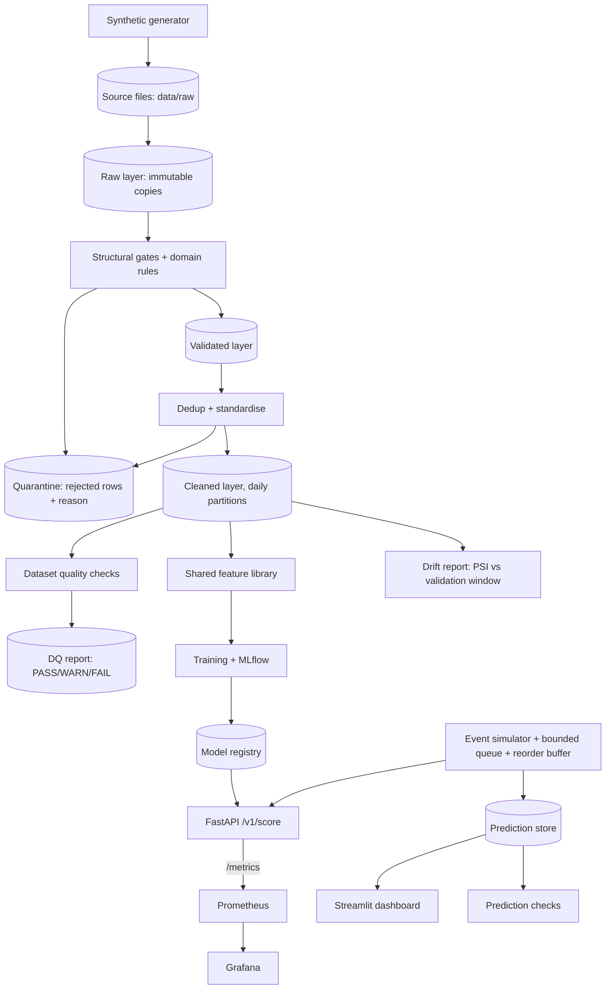

# Architecture

## Principles
Local-first and $0. Cloud is optional and separate. One shared feature library for training and serving. Simplicity over resume-driven complexity.

## System overview (local)

## Data flow
1. The generator writes source files to `data/raw/` (it plays the role of a source-system export).
2. Ingestion copies each file verbatim into the **raw** layer (`data/processed/raw`, immutable) and records it in a ledger keyed by the file's SHA-256, so re-runs are idempotent.
3. Structural gates (readable, schema, types, required fields) and domain rules (amounts, timestamps, categories, consistency, identifier formats) split rows into **validated** and **quarantine** (with a reason). See `docs/data-quality.md`.
4. Duplicates are resolved first-write-wins; identical copies are dropped and counted, conflicting copies are quarantined. The **cleaned** layer is standardised and partitioned by event date, with lineage columns on every row (`_batch_id`, `_source_file`, `_row_number`, `_ingested_at`).
5. After ingestion, dataset checks (completeness, duplicates, referential integrity, label timing, volume, drift, freshness, consistency) produce a PASS/WARN/FAIL report (`python -m mmrisk.validation check`).
6. Shared feature library computes behavioral features using only past data (point-in-time correct).
7. The model scores each transaction; the API (`POST /v1/score`) returns the calibrated probability, the cost-based action, the risk level, the feature version and reason codes for flagged transactions (exact tree contributions). It records each scored transaction as history for the customer's later ones.
8. Predictions are stored (by the event simulator, Phase 13) for the dashboard and drift monitoring. The API exposes counters and timings at `/metrics` for Prometheus (Phase 14), and `python -m mmrisk.monitoring report` checks the stored predictions. `python -m mmrisk.drift report` (Phase 15) compares the features and scores of a lake window with a frozen reference from the validation window.

## ML lifecycle
Time-based split, then rule baseline, Logistic Regression, Random Forest, LightGBM. Select on PR-AUC. Choose LOW/MEDIUM/HIGH thresholds from a cost model. Explain with SHAP, document in a model card, log to MLflow. A candidate replaces the champion only if it passes quality gates **and** receives manual approval. Rollback repoints the champion alias to the previous version.

## Local vs optional cloud
| Local (default) | Optional AWS (design, plan-only) | Reason |
|---|---|---|
| Filesystem / MinIO (optional) | S3 | Durable object storage |
| DuckDB + Parquet | S3 + Athena (if needed) | Serverless analytics |
| Prediction store (DuckDB/SQLite, then PostgreSQL) | RDS PostgreSQL | Managed relational DB |
| In-process queue | Kinesis (if streaming is needed) | Managed event stream |
| Docker Compose | ECS Fargate | Containers without managing Kubernetes |
| Prometheus + Grafana | CloudWatch | Managed metrics |
| MLflow | MLflow on ECS or SageMaker (TO VERIFY) | Model lifecycle |

Cloud costs are not stated until current AWS pricing is verified. Terraform is validate/plan only; `apply` requires explicit approval.

## Hardware constraints (developer machine)
8 GB RAM, 2 cores / 4 threads. Native-first development, 200k-500k rows, Docker memory capped via `.wslconfig`, no Kafka/Redpanda.
