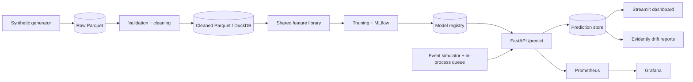

# Architecture

## Principles
Local-first and $0. Cloud is optional and separate. One shared feature library for training and serving. Simplicity over resume-driven complexity.

## System overview (local)

## Data flow
1. Generator writes **raw** Parquet, immutable, partitioned by date.
2. Validation checks schema, nulls, duplicates, ranges, categories, referential integrity, freshness.
3. **Cleaned** layer: deduplicated, idempotent re-runs, lineage columns (source file, run id, ingest time).
4. Shared feature library computes behavioral features using only past data (point-in-time correct).
5. Model scores each transaction; the API returns score, level, model version, timestamp and SHAP explanation.
6. Predictions are stored for the dashboard and drift monitoring.

## ML lifecycle
Time-based split, then rule baseline, Logistic Regression, Random Forest, LightGBM. Select on PR-AUC. Choose LOW/MEDIUM/HIGH thresholds from a cost model. Explain with SHAP, document in a model card, log to MLflow. A candidate replaces the champion only if it passes quality gates **and** receives manual approval. Rollback repoints the champion alias to the previous version.

## Local vs optional cloud
| Local (default) | Optional AWS (design, plan-only) | Reason |
|---|---|---|
| Filesystem / MinIO (optional) | S3 | Durable object storage |
| DuckDB + Parquet | S3 + Athena (if needed) | Serverless analytics |
| Prediction store (DuckDB/SQLite, then PostgreSQL) | RDS PostgreSQL | Managed relational DB |
| In-process queue | Kinesis (if streaming is needed) | Managed event stream |
| Docker Compose | ECS Fargate | Containers without managing Kubernetes |
| Prometheus + Grafana | CloudWatch | Managed metrics |
| MLflow | MLflow on ECS or SageMaker (TO VERIFY) | Model lifecycle |

Cloud costs are not stated until current AWS pricing is verified. Terraform is validate/plan only; `apply` requires explicit approval.

## Hardware constraints (developer machine)
8 GB RAM, 2 cores / 4 threads. Native-first development, 200k-500k rows, Docker memory capped via `.wslconfig`, no Kafka/Redpanda.
