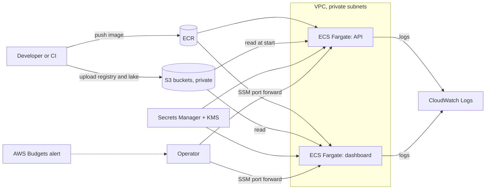

# AWS design (Phase 21)

**Status: a design only.** No AWS account was used, nothing was created, nothing costs money. Phase 22 turns this into Terraform that can only `validate` and `plan`; `apply` needs your explicit approval and is not part of the project's default path. The data stays synthetic, so nothing here is a statement about handling real mobile-money data. Decision record: [ADR-026](adr/ADR-026-aws-design.md).

Everything about AWS behaviour below comes from my knowledge of the services, not from running them. Anything I could not check against AWS documentation or a pricing page is marked **TO VERIFY**. Figures that are my choice are marked **ASSUMED**.

## 1. Goal and non-goals
**Goal.** Show how the Phase 20 local deployment would run on AWS with managed building blocks, with least-privilege access, no public attack surface by default, and a cost that can be switched off.

**Non-goals.** High availability, auto-scaling to real traffic, multi-region, compliance claims, real data, a Kubernetes platform, a data warehouse. None is needed for a one-person portfolio demo and each would add cost and surface.

## 2. Mapping from the local stack
| Local (Phase 20) | AWS | Why / what changes |
|---|---|---|
| `docker-compose.prod.yml` `api` | ECS service on Fargate, 1 task | Containers without managing servers. Same image, same read-only and non-root settings where Fargate allows. |
| `dashboard` | Second ECS service, 1 task | Same. Internal only. |
| `secrets\` files | AWS Secrets Manager (keys, certificate, passwords), KMS | Local files become secrets; see the gap in section 5. |
| `data\processed` (lake) | S3 bucket, private | Parquet layers stay as they are. |
| `models\registry` | S3 prefix, versioned bucket | The registry is a folder of files; S3 keeps it as objects. |
| `data\audit`, logs | CloudWatch Logs (container output) and S3 (audit file, archived) | The API already writes JSON lines. |
| Prometheus and Grafana | Not moved in this design | See section 8. |
| Retraining on the host | Run where it is run today (your machine or a CI job), then upload the registry to S3 | See section 7. |
| `deploy preflight` / `verify` | Same commands, pointed at the AWS endpoint | `verify` already tests from outside. |
| Backup archive | S3 versioning plus lifecycle rules; the archive command still works | |

No relational database is added. The prediction store is files, and nothing in the platform needs a transactional database; adding RDS would be cost without a reason (ADR-026).

## 3. Architecture

Nothing is published to the internet. The operator reaches the services through an SSM Session Manager port forward to the tasks (ECS Exec or a small SSM-enabled host; **TO VERIFY** which works with Fargate tasks in this setup). That removes the load balancer, the domain name and the public attack surface from the demo.

## 4. Network
Decision (ASSUMED, section 11 lists it as yours to confirm): **one VPC, tasks in private subnets, no inbound rules except between the services, no public IP on tasks.**

Tasks need to reach ECR, S3, Secrets Manager and CloudWatch. Three ways:

| Option | Cost shape | Risk |
|---|---|---|
| A. NAT gateway | An hourly charge plus a per-GB charge, running whether or not traffic flows | Simple; the most expensive idle line (section 10) |
| B. VPC endpoints (S3 gateway endpoint, interface endpoints for ECR, Secrets Manager, Logs) | The S3 gateway endpoint is free (**TO VERIFY**); each interface endpoint has an hourly charge (not verified) | More resources to define; no internet path |
| C. Tasks in public subnets with public IPs, security group allowing nothing inbound | No NAT or endpoint charge; a public IPv4 address has an hourly charge (section 10) | Tasks sit on the public internet with only a security group in front; acceptable only for a short demo |

Recommendation: **B for anything left running; C only for a session of a few hours that you tear down.** A is the fallback if B proves too fiddly. Choose before Phase 22.

## 5. Compute and secrets (the part that needs a code change)
Task definitions mirror the compose file: non-root user 10001, `readonlyRootFilesystem`, capabilities dropped (Fargate allows dropping; **TO VERIFY**), CPU and memory fixed, `awslogs` log driver, health check running the same TLS call as today.

Sizes (ASSUMED, not measured on AWS): API 1 vCPU, 2 GB (Phase 19 found one core is the limit; the local container ran within 1 GB, 1 CPU); dashboard 0.5 vCPU, 1 GB. Whether these combinations are valid Fargate sizes is **TO VERIFY**.

**Gaps found while designing, not solved yet:**
1. **Secrets are files locally, environment variables on ECS.** ECS injects Secrets Manager values as environment variables, but the API reads `--auth-keys`, `--tls-cert` and `--tls-key` as files. A small start-up script must write them to a writable volume before the server starts. Fargate has no `tmpfs`, so that needs a task volume (**TO VERIFY**). Needs a change in a later phase (Phase 22 plans only; a wrapper script is code).
2. **The registry and lake are local folders.** The API must copy them from S3 at start (it replays the history from the lake, 200,000 transactions in the local run). That needs an S3 client in the image (a new dependency) or the AWS CLI. Also a later change.
3. **Promotion needs a restart.** The API loads the production model once. On ECS a promotion is "upload `production.json`, then force a new deployment of the service".
4. **TLS.** The API refuses to listen outside loopback without keys and TLS, so keep the self-signed certificate inside the VPC; no ACM certificate or domain is needed while access is by port forward. A public HTTPS endpoint would need a domain, an ACM certificate and a load balancer, which this design leaves out on purpose.

## 6. Data
- Buckets (names ASSUMED to be per-account unique): `lake`, `registry`, `backups`. Block Public Access on, versioning on for `registry` and `backups`, server-side encryption (SSE-KMS with one customer key, or the default S3-managed encryption if the key cost is not wanted; the key price is not verified), TLS-only bucket policy, lifecycle rules to expire old versions and incomplete uploads.
- The tasks get read-only access to `lake` and `registry`; only the uploader (you or CI) can write them. The API never writes to S3.
- Synthetic data only: no personal data, so no data-residency requirement. A region near Nairobi (Cape Town, `af-south-1`) is a latency option; its prices and service availability are **TO VERIFY** and it is an opt-in region in the account.

## 7. Retraining
Keep it where it is: the host (or a CI job) trains, applies the gates, writes the registry; an explicit upload copies the new version to S3; promotion is `production.json` plus a service restart. Running retraining as a scheduled Fargate task is possible (EventBridge Scheduler) but needs the training libraries in a second image, write access to the registry bucket, and a person still approves promotion. Not worth it for this size (ADR-026).

## 8. Observability
- Logs: container output to CloudWatch Logs with a retention period (ASSUMED 14 days) and a log-group per service. The API's access and audit lines are already JSON.
- Alarms: ECS service running count below one, and task restarts; an AWS Budgets alert (section 10).
- Not moved: Prometheus and Grafana. The API's `/metrics` needs a bearer token, and CloudWatch cannot scrape it. Options (Amazon Managed Prometheus, an ADOT collector sidecar, running Prometheus in a task) all add cost and moving parts. The local monitoring from Phase 14 stays the reference, and the dashboard's own Health tab reads files. Decide later whether the demo needs live metrics on AWS.

## 9. Identity and access
- **Task execution role** (pull the image, write logs, read the named secrets only) and **task role** (read-only on the two buckets and the secrets it needs). No wildcard resources.
- **Human access** through IAM Identity Center or a named role with MFA; **no long-lived access keys** in the repository or on the machine.
- **GitHub Actions** assumes a role by OpenID Connect (no stored keys), limited to this repository and branch; in Phase 22 that role can only run `plan`.
- Separate roles for "push image" and "change infrastructure". Nothing runs as the account root.
- Every resource tagged `project=mmrisk`, `phase`, `owner`, `expires` so a leftover is visible and deletable.

## 10. Costs
**What is sourced.** Prices below were read on 2026-11-06 from AWS pages through a tool that summarises the page, so a figure could be mis-copied; they also change, so recheck before relying on them. Region in the examples is US East (N. Virginia) unless stated.

| Item | Price read | Source |
|---|---|---|
| Fargate, Linux/x86, vCPU | $0.000011244 per vCPU-second (about $0.0405 per vCPU-hour) | [Fargate pricing](https://aws.amazon.com/fargate/pricing/), the page's pricing examples |
| Fargate, Linux/x86, memory | $0.000001235 per GB-second (about $0.00445 per GB-hour) | [Fargate pricing](https://aws.amazon.com/fargate/pricing/) |
| Fargate ephemeral storage | $0.0000000308 per GB-second beyond 20 GB included | [Fargate pricing](https://aws.amazon.com/fargate/pricing/) |
| NAT gateway | $0.045 per hour and $0.045 per GB processed, **as printed for US East (Ohio)** (the N. Virginia rate was not on the fetched text) | [VPC pricing](https://aws.amazon.com/vpc/pricing/) |
| Public IPv4 address | $0.005 per hour, in use or idle | [VPC pricing](https://aws.amazon.com/vpc/pricing/) |

**Arithmetic on those numbers only** (730 hours as one month is my convention, compute shown to the cent):
- API task 1 vCPU, 2 GB, running all month: about $36.04. Dashboard 0.5 vCPU, 1 GB: about $18.02. Together about $54 a month if left running (ASSUMED sizes).
- The same API task for 8 hours: about $0.39 (8 x about $0.0494 per hour).
- One NAT gateway left running all month: about $32.85 before any data charge. One public IPv4 address: about $3.65.

**Not verified, so no number is given:** Secrets Manager, KMS, ECR storage, S3 storage and requests, CloudWatch Logs ingestion and storage, interface VPC endpoints, load balancers, AWS Budgets, data transfer, Cape Town prices, free-tier eligibility. The project's rule stands: no cost is stated until a pricing page has been read. Phase 23 reads those before the cost guide is written.

**Controls designed in:**
- Nothing runs by default; `desired count = 0` is the resting state, and a teardown is a single documented command in Phase 23.
- No NAT gateway unless chosen, no load balancer, no RDS, no multi-AZ, no reserved capacity.
- An AWS Budgets budget with email alerts at fixed fractions of a limit you choose (budget rules and the alert delay are **TO VERIFY**; a budget alerts, it does not stop spend).
- Tags with an expiry date, a weekly look at the bill, log retention set, bucket lifecycle rules, image tags cleaned from ECR.
- A short written list of what to delete if you stop (Phase 23).

## 11. Decisions for you
| Decision | Options | My lean |
|---|---|---|
| Region | us-east-1 (cheapest and widest service list, per general knowledge, unverified) / eu-west-1 / af-south-1 (closest, opt-in, **TO VERIFY**) | us-east-1 for the demo; synthetic data has no residency need |
| Network | A, B or C in section 4 | B; C only for a short session |
| Public endpoint | Port forward only / load balancer with a domain | Port forward only |
| Secrets | Secrets Manager / SSM Parameter Store SecureString | Secrets Manager (rotation exists, **TO VERIFY** cost) |
| Do you want any AWS spend at all | Design and plan only (Terraform, no apply) / one short applied demo | Plan only unless a live demo is needed |

## 12. Rejected
- **EKS or self-managed Kubernetes:** a cluster fee and operations work for two containers.
- **EC2 instances:** patching and capacity are yours; Fargate removes both at a small premium (the premium itself is not computed here).
- **Lambda for the API:** the scoring service keeps per-customer history in memory for the ordering rule and takes a minute to replay; a function that starts cold would replay it every time.
- **App Runner:** not evaluated (**TO VERIFY**); ECS keeps the compose-to-task mapping closest.
- **RDS and a warehouse:** no transactional or analytic need in this project.
- **Public load balancer by default:** a domain, a certificate and a public endpoint for a demo nobody needs to reach from outside.

## 13. What is checked
A unit test reads this document: required sections present, the cost figures only in the cost section, every diagram parses with Mermaid when its CLI is available, and no `.tf` file exists yet (Terraform arrives in Phase 22). Nothing here has been checked against AWS.
