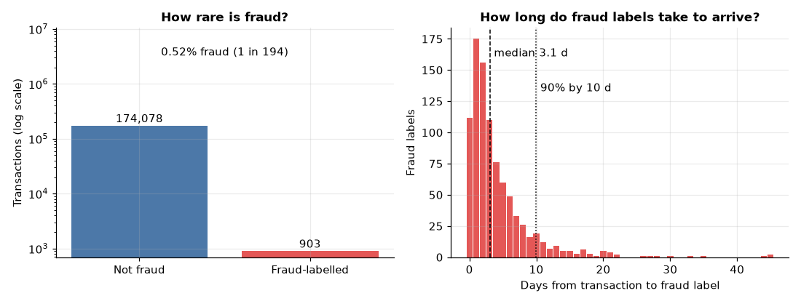
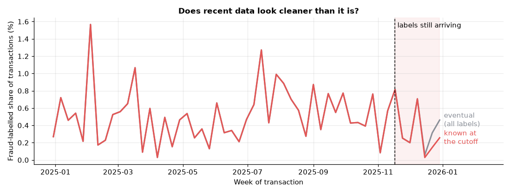
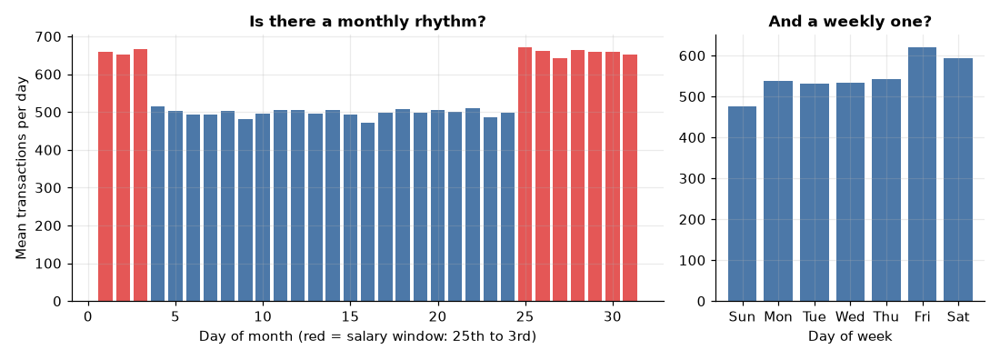
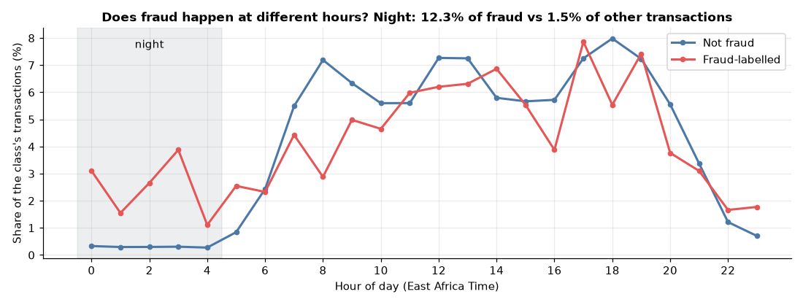
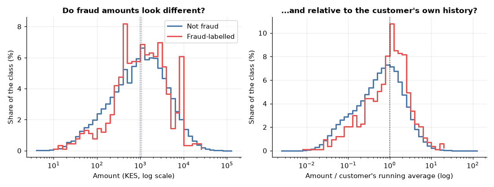
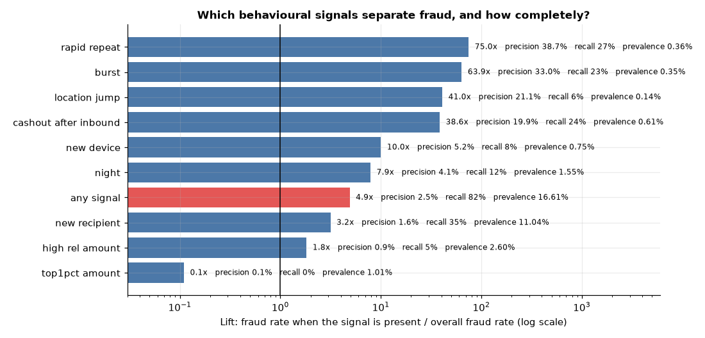
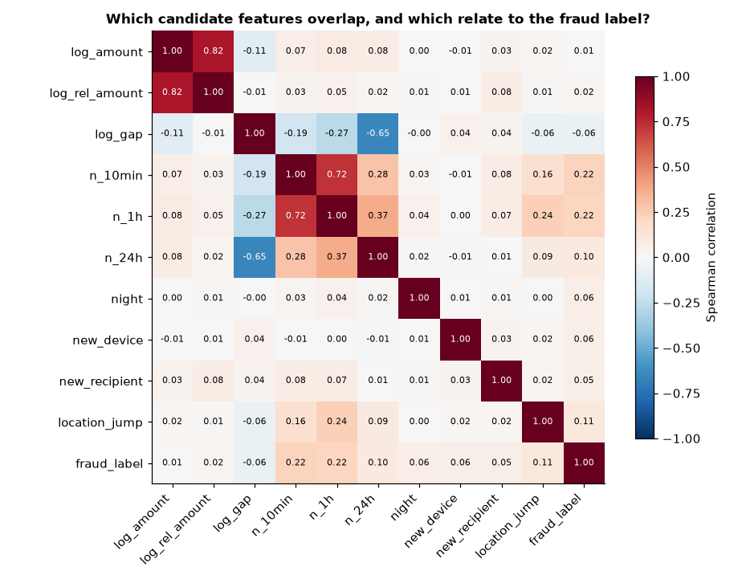

# Exploratory data analysis

> **All data is synthetic.** Findings describe how this simulated dataset behaves, not real mobile-money traffic. This report is generated by `python -m mmrisk.eda`; every number below is computed from the data lake, so re-running it on regenerated data refreshes the report.

Analysis time (end of data): **2025-12-31 23:55:49**. Transactions older than 45 days at that time (up to **2025-11-16 23:55:49**) are called *matured*: their labels are final. Label-based statistics use matured transactions only, because newer ones are still missing fraud labels (see question 2). Source batches: customers: b63e0a1891ae792f; labels: 9545d3e374795eb4; merchants: ca70240727af321e; transactions: d512b61cf4db2532.

## Key findings

- **Scale.** 200,000 transactions from 5,000 customers between 2025-01-01 and 2025-12-31; 174,981 (87%) are matured.
- **Rare class.** 903 of 174,981 matured transactions are labelled fraud (0.52%, about 1 in 194).
- **Slow labels.** Median 3.1 days from transaction to fraud label, 90% within 10 days, up to 45. In the last 14 days of data only 11 of 23 eventual fraud labels are known (52% still hidden).
- **Night.** 12.3% of fraud-labelled transactions happen between 00:00 and 04:59, against 1.5% of the rest (8.2x as often).
- **Amounts.** In absolute terms fraud and non-fraud look alike (median 1,059 vs 1,000 KES). Relative to the customer's own running average they differ: median 1.02x vs 0.63x (1.6x higher).
- **Signals.** Strongest single signals by lift: rapid repeat (75x), burst (64x), location jump (41x). All simple signals combined flag 16.6% of transactions and catch 82% of fraud at 2.5% precision.
- **Clustering.** 324 of 5,000 customers have at least one fraud-labelled transaction, and 82% of fraud rows belong to customers with more than one.

## 1. How rare is fraud?

Of 174,981 matured transactions, 903 carry a fraud label. A model that always answers "not fraud" would be 99.48% accurate and useless, so accuracy is not a usable metric here. A random scorer has a precision-recall AUC equal to the prevalence (0.52%); that is the floor any model must beat, which is why PR-AUC is the primary metric (ADR-008 of the plan, to be written in Phase 7).

## 2. Does recent data look cleaner than it is?

Fraud labels arrive after a delay (right panel of figure 1), and non-fraud labels are only confirmed after the 45-day dispute window. The grey line is the fraud rate once every label has arrived; the red line is what was actually known at the cutoff. They split in the final weeks: in the last 14 days 11 of 23 eventual fraud labels were known. The grey line exists only because this simulation holds future labels; a real system would never see it.

**Consequence for modelling:** training data must use only labels whose `label_available_at` is on or before the training cutoff, and the last ~45 days before any cutoff cannot be treated as clean negatives. Week-to-week rates are also noisy (roughly 17 fraud rows per week), so small weekly movements mean little.

## 3. When do transactions and fraud happen?

Volume rises in the salary window (25th to 3rd): 659 transactions per day against 498 on other days (1.32x). The weekday panel shows the weekly pattern.

Most activity is in the daytime for both classes, but fraud has a visible night component: 12.3% of fraud against 1.5% of other transactions happens before 05:00. Night is a useful but incomplete signal: 88% of fraud happens in daytime.

## 4. Do fraud amounts look different?

Absolute amounts overlap almost completely (medians 1,059 and 1,000 KES). Amounts just under 10,000 KES (9,500 to 9,990, the structuring range) are 3.8% of fraud-labelled transactions against 0.4% of the rest. Compared with the customer's own running average (customers with at least 3 prior transactions) the fraud distribution shifts right: median 1.02x against 0.63x. A feature that scales the amount by the customer's history will carry more information than the raw amount.

| Type | Transactions | Median KES | 99th pct KES | Fraud rate |
|---|---|---|---|---|
| SEND_MONEY | 43,516 | 1,050 | 14,000 | 0.93% |
| TILL | 35,606 | 461 | 4,850 | 0.21% |
| AGENT_WITHDRAWAL | 31,470 | 1,910 | 18,600 | 0.90% |
| AIRTIME | 24,617 | 96 | 750 | 0.33% |
| PAYBILL | 22,116 | 1,950 | 16,073 | 0.21% |
| AGENT_DEPOSIT | 17,656 | 4,450 | 34,795 | 0.07% |

## 5. Who and where?

Fraud rate by group with a 95% interval. "higher" or "lower" is shown only when the interval excludes the overall rate (0.52%); small groups usually come out "not distinct", which is the honest reading.

| Dimension | Value | Transactions | Fraud | Rate | 95% interval | Lift | vs overall |
|---|---|---|---|---|---|---|---|
| transaction type | SEND_MONEY | 43,516 | 405 | 0.93% | 0.84% to 1.03% | 1.8x | higher |
| transaction type | TILL | 35,606 | 73 | 0.21% | 0.16% to 0.26% | 0.4x | lower |
| transaction type | AGENT_WITHDRAWAL | 31,470 | 284 | 0.90% | 0.80% to 1.01% | 1.7x | higher |
| transaction type | AIRTIME | 24,617 | 81 | 0.33% | 0.26% to 0.41% | 0.6x | lower |
| transaction type | PAYBILL | 22,116 | 47 | 0.21% | 0.16% to 0.28% | 0.4x | lower |
| transaction type | AGENT_DEPOSIT | 17,656 | 13 | 0.07% | 0.04% to 0.13% | 0.1x | lower |
| channel | USSD | 106,777 | 409 | 0.38% | 0.35% to 0.42% | 0.7x | lower |
| channel | APP | 68,204 | 494 | 0.72% | 0.66% to 0.79% | 1.4x | higher |
| segment | SMALL_BUSINESS | 60,040 | 182 | 0.30% | 0.26% to 0.35% | 0.6x | lower |
| segment | INFORMAL_WORKER | 50,098 | 349 | 0.70% | 0.63% to 0.77% | 1.3x | higher |
| segment | SALARIED | 47,347 | 225 | 0.48% | 0.42% to 0.54% | 0.9x | not distinct |
| segment | STUDENT | 17,496 | 147 | 0.84% | 0.72% to 0.99% | 1.6x | higher |
| counterparty type | MERCHANT | 57,722 | 120 | 0.21% | 0.17% to 0.25% | 0.4x | lower |
| counterparty type | AGENT | 49,126 | 297 | 0.60% | 0.54% to 0.68% | 1.2x | higher |
| counterparty type | CUSTOMER | 43,516 | 405 | 0.93% | 0.84% to 1.03% | 1.8x | higher |
| counterparty type | NONE | 24,617 | 81 | 0.33% | 0.26% to 0.41% | 0.6x | lower |
| county | Nairobi | 54,794 | 234 | 0.43% | 0.38% to 0.49% | 0.8x | lower |
| county | Mombasa | 18,007 | 90 | 0.50% | 0.41% to 0.61% | 1.0x | not distinct |
| county | Kiambu | 17,120 | 57 | 0.33% | 0.26% to 0.43% | 0.6x | lower |
| county | Kisumu | 12,648 | 59 | 0.47% | 0.36% to 0.60% | 0.9x | not distinct |
| county | Nakuru | 12,572 | 60 | 0.48% | 0.37% to 0.61% | 0.9x | not distinct |
| county | Machakos | 9,837 | 35 | 0.36% | 0.26% to 0.49% | 0.7x | lower |
| county | Kisii | 9,809 | 45 | 0.46% | 0.34% to 0.61% | 0.9x | not distinct |
| county | Uasin Gishu | 9,612 | 77 | 0.80% | 0.64% to 1.00% | 1.6x | higher |
| county | Meru | 9,054 | 34 | 0.38% | 0.27% to 0.52% | 0.7x | not distinct |
| county | Nyeri | 8,046 | 22 | 0.27% | 0.18% to 0.41% | 0.5x | lower |
| county | Kakamega | 7,861 | 88 | 1.12% | 0.91% to 1.38% | 2.2x | higher |
| county | Garissa | 5,621 | 102 | 1.81% | 1.50% to 2.20% | 3.5x | higher |

**Customers.** Activity is uneven: the busiest 10% of customers make 28% of all transactions, and small businesses transact far more than students:

| Segment | Customers | Median txns | 90th pct | 99th pct | Max |
|---|---|---|---|---|---|
| INFORMAL_WORKER | 1,715 | 28 | 61 | 111 | 184 |
| SALARIED | 1,492 | 30 | 65 | 126 | 214 |
| SMALL_BUSINESS | 1,035 | 56 | 121 | 221 | 343 |
| STUDENT | 758 | 22 | 47 | 87 | 138 |

**Victims cluster.** 324 customers have fraud-labelled transactions; 82% of fraud rows sit on customers with more than one, and one customer has 18. Fraud arrives as episodes (bursts, takeovers), not as isolated rows. Splitting rows at random between training and test would put parts of the same episode on both sides and overstate performance; the evaluation must split by time.

**Counterparties.** The 10 busiest merchants take 2.5% of merchant payments and the 10 busiest agents 9.0% of agent transactions, so no single merchant or agent dominates. Share of fraud by counterparty type:

| Counterparty | Share of fraud |
|---|---|
| CUSTOMER | 44.9% |
| AGENT | 32.9% |
| MERCHANT | 13.3% |
| NONE | 9.0% |

## 6. Which behavioural signals separate fraud?

Each signal uses only information available at the time of the transaction (the customer's earlier history, never later rows). *Precision* is the fraud rate among transactions where the signal fires; *lift* divides that by the overall rate; *recall* is the share of all fraud the signal fires on.

| Signal | Fires on | Precision | Lift | Recall |
|---|---|---|---|---|
| Night-time (00:00 to 04:59) | 1.55% | 4.1% | 7.9x | 12.3% |
| First time this device is used by the customer | 0.75% | 5.2% | 10.0x | 7.5% |
| First transfer to this recipient | 11.04% | 1.6% | 3.2x | 34.9% |
| Amount above 5x the customer's running average | 2.60% | 0.9% | 1.8x | 4.8% |
| Within 2 minutes of the customer's previous transaction | 0.36% | 38.7% | 75.0x | 26.9% |
| 3 or more transactions in the previous 10 minutes | 0.35% | 33.0% | 63.9x | 22.6% |
| County changed within 1 hour of the previous transaction | 0.14% | 21.1% | 41.0x | 5.8% |
| Amount in the top 1% of all transactions | 1.01% | 0.1% | 0.1x | 0.1% |
| Agent withdrawal within 2 hours of receiving a transfer | 0.61% | 19.9% | 38.6x | 23.7% |
| Any of the signals above | 16.61% | 2.5% | 4.9x | 81.6% |

No single signal is both precise and complete. The best reach high lift on a small slice of fraud; the combination of every signal reaches 82% recall but flags 16.6% of all transactions and is only 2.5% precise. A model has to combine signals, which is the job of Phases 7 and 8. Large absolute amounts are not a fraud signal here: the top 1% of amounts has lift 0.11x.

## 7. Which candidate features overlap?

Spearman rank correlations on matured transactions. Features measuring the same thing overlap (amount and relative amount; the 10-minute and 1-hour counts), so a linear model would see collinearity and tree models would split importance between them. No single feature correlates strongly with the fraud label (largest: n 10min, 0.22), which is expected for a rare event driven by combinations of behaviours; rank correlation with a binary label this rare understates usefulness.

## 8. Audit against ground truth

> **This section uses the hidden ground truth, which a real analyst would not have.** It exists to check the simulation and the labels. Ground truth is never used for features, labels or any other analysis in this report.

Among matured transactions 893 are truly fraudulent, of which 806 (90%) were reported. 97 legitimate transactions were reported as fraud, so 10.7% of the fraud-labelled set is not fraud. With a rare positive class even a tiny false-report rate is a noticeable share of the positives; this puts a ceiling on achievable precision measured against the observed labels.

Share of each true fraud pattern that at least one simple signal fires on (lowest first):

| Pattern | Rows | Reported | Any signal fires | Mean signals |
|---|---|---|---|---|
| AMOUNT_ANOMALY | 19 | 100.0% | 63.2% | 1.1 |
| LOCATION_JUMP | 40 | 90.0% | 67.5% | 1.1 |
| STRUCTURING | 33 | 97.0% | 69.7% | 1.1 |
| BEHAVIORAL_SHIFT | 93 | 95.7% | 71.0% | 0.9 |
| SOCIAL_ENGINEERING | 83 | 91.6% | 79.5% | 0.9 |
| SIM_SWAP | 74 | 89.2% | 87.8% | 1.4 |
| VELOCITY_BURST | 317 | 86.4% | 96.8% | 2.3 |
| MULE_CASHOUT | 234 | 91.5% | 100.0% | 1.3 |

Patterns near the top of this table are the ones simple per-transaction signals miss most; they are where a learned model has the most to add. The cash-out-after-inbound signal was designed knowing how the simulator creates mule cash-outs, so its coverage of that pattern is optimistic compared with real data.

## Implications for the next phases

1. **Time-based splits with a label gap.** Train on earlier data, validate and test on later data, and apply only labels available at the training cutoff. Keep the final ~45 days out of any test set that needs final labels.
2. **Primary metric: PR-AUC**, with the prevalence (0.52%) as the no-skill baseline, plus precision at a fixed review budget. Accuracy and ROC-AUC alone would flatter weak models.
3. **Features that need history.** Amount relative to the customer, counts in the last 10 minutes, 1 hour and 24 hours, time since the previous transaction, first-time device and recipient, county change, and cash-out shortly after an inbound transfer, all computed from earlier rows only.
4. **A rule baseline is worth building first.** The combination of simple signals already reaches 82% recall at 2.5% precision; a model must beat that trade-off to justify itself (Phase 7).
5. **Expect label noise.** The observed labels miss some fraud and include some non-fraud; evaluation should say so and not treat them as truth.

## Limitations

- The data is simulated; relationships here reflect the generator's design. Do not read them as facts about real mobile-money fraud.
- Signal thresholds (5x average, 2 minutes, 10 minutes, 1 hour, 2 hours) are illustrative choices, not tuned.
- Matured statistics ignore the most recent 45 days, so any drift in that window is not visible here.
- Group rates have wide intervals when fraud counts are small; the table marks which differences survive.

