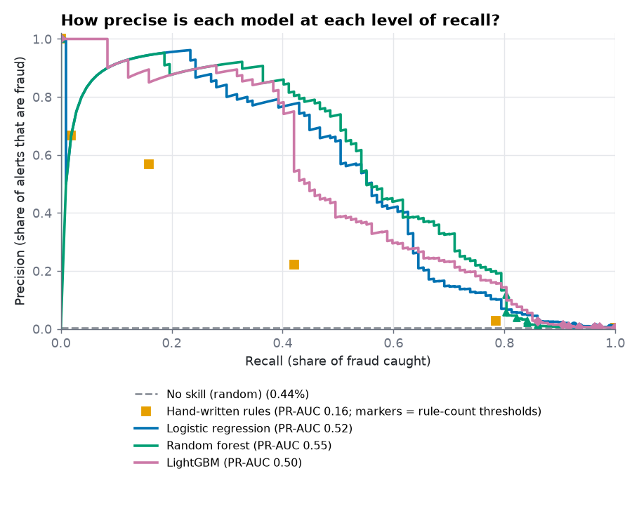
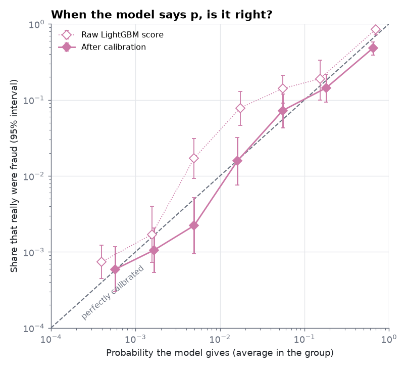
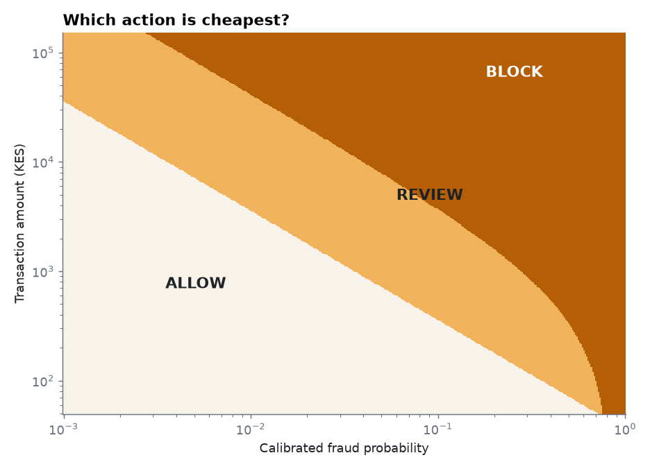
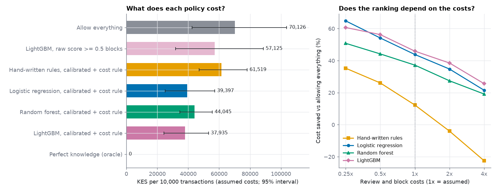

# Advanced model, calibration and cost-based decisions

> **All data is synthetic, and every cost in this report is an assumption.** The costs (review, friction, share of fraud a review stops) are placeholders chosen for this simulation, not measurements from any provider. Savings are therefore "under these assumptions", never a claim about real money. Generated by `python -m mmrisk.models advanced`; every number below is computed from the run.

## Key results

- **Ranking.** LightGBM test PR-AUC is 0.50 (0.37 to 0.64) against 0.55 for the random forest and 0.52 for logistic regression (fraud rate 0.44%). Difference to the random forest: -0.05 (-0.15 to +0.01), not separable from zero (the interval includes zero). Difference to logistic regression: -0.01 (-0.10 to +0.05), not separable from zero (the interval includes zero).
- **Probabilities.** Calibration on the validation window changed LightGBM's calibration error on the test window from 0.0018 to 0.0015 (lower is better) and its Brier score from 0.00297 to 0.00297; a constant guess scores 0.00440.
- **Decisions.** With the assumed costs, the scorer with the lowest cost on the test period is **LightGBM**: 37,935 KES per 10,000 transactions against 70,126 for allowing everything (46% lower), with perfect knowledge at 0. LightGBM's saving is 46%.
- **LightGBM versus the random forest in cost.** Random forest cost minus LightGBM cost is +6,109 KES per 10,000 (-66 to +10,983): not separable from zero (the interval includes zero).
- **A fixed 0.5 cut-off is the wrong tool.** Blocking when LightGBM's raw score is at least 0.5 blocks 35 of 24,224 test transactions and costs 57,125 KES per 10,000 (19% lower than allowing everything); the cost rule above does better by 19,190 KES per 10,000.
- **Spread of the fraud amounts.** The 5 largest fraud-labelled amounts make 17% of the 169,873 KES fraud total in the test period (median fraud 1,200 KES, largest 7,309), so cost is not driven by a handful of transactions; the wide intervals come from the small number of fraud cases, which also come in clusters by customer.

## 1. Does a gradient-boosted model rank fraud better than the baselines?

LightGBM was tuned like the other models: settings and number of boosting rounds chosen on the validation window only (no early stopping inside training, so the training part never sees validation), then the test window scored once. Each row is one setting; "Best rounds" and "Validation PR-AUC" are the best of the stopping points tried (50, 100, 150, 200, 300, 400 rounds).

| Leaves | Min rows per leaf | Class weight | Best rounds | Validation PR-AUC | Chosen |
|---|---|---|---|---|---|
| 4 | 30 | none | 400 | 0.514 |  |
| 4 | 30 | balanced | 300 | 0.285 |  |
| 4 | 60 | none | 400 | 0.512 |  |
| 4 | 60 | balanced | 300 | 0.276 |  |
| 4 | 120 | none | 400 | 0.502 |  |
| 4 | 120 | balanced | 300 | 0.258 |  |
| 8 | 30 | none | 200 | 0.501 |  |
| 8 | 30 | balanced | 150 | 0.344 |  |
| 8 | 60 | none | 300 | 0.514 | yes |
| 8 | 60 | balanced | 400 | 0.322 |  |
| 8 | 120 | none | 300 | 0.500 |  |
| 8 | 120 | balanced | 300 | 0.307 |  |
| 16 | 30 | none | 150 | 0.496 |  |
| 16 | 30 | balanced | 300 | 0.363 |  |
| 16 | 60 | none | 150 | 0.508 |  |
| 16 | 60 | balanced | 400 | 0.334 |  |
| 16 | 120 | none | 150 | 0.478 |  |
| 16 | 120 | balanced | 400 | 0.378 |  |

Among unweighted settings the validation PR-AUC spans only 0.478 to 0.514: the model family is not the limiting factor, and the tuning grid cannot be expected to change the picture. Class weighting lowered validation PR-AUC again, as it did for the Phase 7 models.

| Model | Test PR-AUC (95% interval) | Validation PR-AUC |
|---|---|---|
| No skill (random) | 0.004 (0.003 to 0.006) | 0.006 |
| Hand-written rules | 0.161 (0.066 to 0.278) | 0.134 |
| Logistic regression | 0.515 (0.358 to 0.654) | 0.470 |
| Random forest | 0.552 (0.434 to 0.683) | 0.573 |
| LightGBM | 0.502 (0.365 to 0.641) | 0.514 |

Paired differences (same customer resamples): LightGBM minus rules +0.34 (+0.22 to +0.44); minus random forest -0.05 (-0.15 to +0.01); minus logistic regression -0.01 (-0.10 to +0.05). Only differences whose interval excludes zero should be read as real.

Top features by gain (a rough preview; proper explanations come in Phase 9): `secs_since_prev_txn` 20%, `cashout_after_inbound` 14%, `amount_sum_1h` 11%, `avg_amount_30d` 11%, `secs_since_last_inbound` 7%, `is_away_from_home` 4%, `account_age_days` 3%, `txn_count_1h` 3%.

## 2. Can the scores be read as probabilities?

A probability has to be right before it can be used to price a decision. Scores were calibrated with Platt scaling (a two-parameter logistic curve) fitted on the validation window only; for LightGBM p = sigmoid(1.14 x logit(score) +1.85). The chart groups test transactions by the probability given and shows how many really were fraud; points on the dashed line are perfect, and groups with no fraud cannot be drawn on a log scale (they are in the table).

| Probability group | Transactions | Fraud | Predicted (calibrated) | Observed (95% interval) |
|---|---|---|---|---|
| 0 to 0.001 | 13,527 | 8 | 0.06% | 0.06% (0.03% to 0.12%) |
| 0.001 to 0.003 | 7,598 | 8 | 0.17% | 0.11% (0.05% to 0.21%) |
| 0.003 to 0.01 | 2,251 | 5 | 0.49% | 0.22% (0.09% to 0.52%) |
| 0.01 to 0.03 | 445 | 7 | 1.61% | 1.57% (0.76% to 3.21%) |
| 0.03 to 0.1 | 179 | 13 | 5.54% | 7.26% (4.29% to 12.03%) |
| 0.1 to 0.3 | 125 | 18 | 18.09% | 14.40% (9.31% to 21.62%) |
| 0.3 to 1 | 99 | 48 | 65.38% | 48.48% (38.88% to 58.20%) |

The validation window has a fraud rate of 0.62% and the test window 0.44%. A calibrator fitted on one window carries that rate with it, so some gap on the next window is expected; this is a reason to re-check calibration regularly (Phase 14).

In the highest-probability group (0.3 to 1, 99 transactions) the model gives 65% on average and 48% were fraud (39% to 58%): overconfident: the model's probability is above the observed rate (interval excludes the prediction).

| Scorer | Calibration error (test) | Brier score (test) |
|---|---|---|
| LightGBM, raw | 0.0018 | 0.00297 |
| Hand-written rules, calibrated | 0.0014 | 0.00384 |
| Logistic regression, calibrated | 0.0012 | 0.00282 |
| Random forest, calibrated | 0.0031 | 0.00264 |
| LightGBM, calibrated | 0.0015 | 0.00297 |
| Constant guess (training fraud rate) | n/a | 0.00440 |

## 3. The cost model (assumed)

Three actions, from the probability alone: **allow** (risk level LOW), **review** (MEDIUM: hold for a verification or an analyst) and **block** (HIGH: decline or require step-up authentication). The action with the lowest expected cost is chosen; no label is involved.

| Assumption | Value | Meaning |
|---|---|---|
| Loss rate | 1 | Share of a fraudulent amount lost if it gets through (1 = nothing recovered) |
| Review cost | 25 KES | Paid on every review (analyst time, verification message) |
| Review prevents | 70% | Share of fraud a review stops |
| Block cost | 150 KES | Friction paid when a legitimate transaction is blocked |

| Amount | Review from probability | Block from probability |
|---|---|---|
| 100 KES | 35.7% | 69.4% |
| 1,000 KES | 3.6% | 27.8% |
| 10,000 KES | 0.4% | 4.0% |

Because the cost of letting fraud through grows with the amount, the same probability leads to a stricter action on a large transaction than on a small one.

## 4. What does acting on the scores cost on the test period?

| Policy | Cost per 10,000 transactions, KES (95% interval) | Saved vs allow-all | Reviews per 10,000 | Blocks per 10,000 | Fraud blocked | Fraud reviewed | Fraud allowed |
|---|---|---|---|---|---|---|---|
| Allow everything | 70,126 (42,592 to 103,687) | 0% | - | - | - | - | - |
| LightGBM, raw score >= 0.5 blocks | 57,125 (31,788 to 88,544) | 19% | - | - | - | - | - |
| Hand-written rules, calibrated + cost rule | 61,519 (47,076 to 78,128) | 12% | 539 | 77 | 18% | 33% | 50% |
| Logistic regression, calibrated + cost rule | 39,397 (25,172 to 57,108) | 44% | 228 | 64 | 45% | 26% | 29% |
| Random forest, calibrated + cost rule | 44,045 (34,544 to 55,551) | 37% | 601 | 85 | 53% | 25% | 21% |
| LightGBM, calibrated + cost rule | 37,935 (24,363 to 53,101) | 46% | 216 | 65 | 46% | 26% | 28% |
| Perfect knowledge (oracle) | 0 (0 to 0) | 100% | - | - | - | - | - |

LightGBM blocked 109 legitimate transactions in the test period. Costs use the observed labels, which miss some fraud and include some false reports (section 5).

PR-AUC treats every transaction equally, while the cost rule weights errors by amount, so the two measures can order scorers differently. Here the learned scorers rank Random forest > Logistic regression > LightGBM by PR-AUC and LightGBM < Logistic regression < Random forest by cost; the differences are within the intervals above.

### Sensitivity to the assumed costs

The same calibrated probabilities, with the actions re-derived under other assumptions. Saving versus allowing everything (a larger number is better).

| Review and block costs | Hand-written rules | Logistic regression | Random forest | LightGBM |
|---|---|---|---|---|
| 0.25x | 35% | 65% | 51% | 61% |
| 0.5x | 26% | 54% | 44% | 56% |
| 1x (assumed) | 12% | 44% | 37% | 46% |
| 2x | -4% | 35% | 27% | 39% |
| 4x | -22% | 22% | 19% | 26% |

| Share of fraud a review stops | Hand-written rules | Logistic regression | Random forest | LightGBM |
|---|---|---|---|---|
| 50% | -0% | 35% | 29% | 42% |
| 70% (assumed) | 12% | 44% | 37% | 46% |
| 90% | 31% | 56% | 45% | 59% |

The scorer with the largest saving changes with the assumed costs (0.25x: Logistic regression, 0.5x: LightGBM, 1x: LightGBM, 2x: LightGBM, 4x: LightGBM), so no scorer should be called best in cost terms without real cost figures.

## 5. Audit against ground truth

> **This section uses the hidden ground truth, which a real team would not have.** Nothing here influenced training, tuning, calibration or the decision rule.

Against the true fraud flag (109 true fraud rows in the test period) the scorers' PR-AUC and saving versus allowing everything are:

| Scorer | PR-AUC vs truth | Saving vs allow-all (true labels) | Saving (observed labels) |
|---|---|---|---|
| Hand-written rules | 0.23 | 18% | 12% |
| Logistic regression | 0.63 | 52% | 44% |
| Random forest | 0.67 | 46% | 37% |
| LightGBM | 0.59 | 53% | 46% |

What happens to each true fraud pattern under the LightGBM policy (test period):

| Pattern | Rows | Blocked | Reviewed | Allowed |
|---|---|---|---|---|
| BEHAVIORAL_SHIFT | 19 | 21% | 42% | 37% |
| LOCATION_JUMP | 4 | 100% | 0% | 0% |
| MULE_CASHOUT | 25 | 64% | 32% | 4% |
| SIM_SWAP | 18 | 78% | 22% | 0% |
| SOCIAL_ENGINEERING | 13 | 15% | 38% | 46% |
| VELOCITY_BURST | 30 | 53% | 23% | 23% |

## What this does not show

- The data is simulated and the cost numbers are placeholders; the savings above say nothing about real money.
- The test period has 107 fraud-labelled transactions, so intervals are wide and differences between scorers are mostly not separable.
- The author looked at one LightGBM test PR-AUC while building the code, before the grid was extended because the best setting sat at the edge of the first grid; no setting was changed to improve test results. The baselines come from the Phase 7 run unchanged.
- Calibration is fitted on one validation window and measured on one test window with a different fraud rate; it is not guaranteed to hold later.
- Review and block outcomes are modelled with fixed shares, not observed; a real review process has delays, errors and capacity limits that this does not capture.
- Amount-based decisions assume the loss equals a fixed share of the amount; a real provider would also have limits, reversals and regulatory costs.

