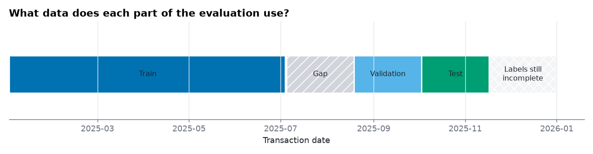
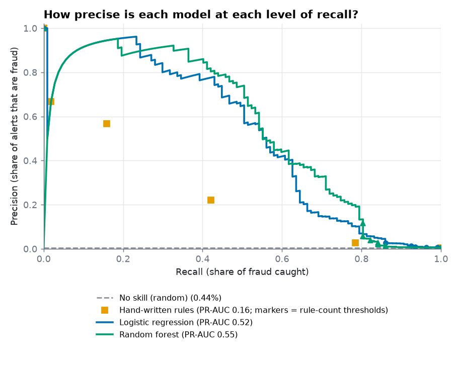
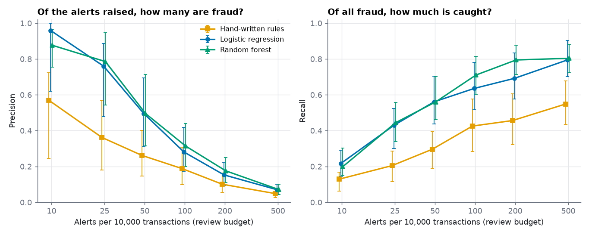

# Baseline models

> **All data is synthetic.** These numbers describe how simple models do on a simulated dataset, not how they would do on real mobile-money fraud. Generated by `python -m mmrisk.models train`; every number below is computed by that run.

## Key results

- **Setup.** Train on transactions up to 2025-07-04, tune on 2025-08-18 to 2025-10-02, test on 2025-10-02 to 2025-11-16, with a 45-day gap between training and validation so that labels and fraud episodes cannot cross the boundary.
- **Test PR-AUC** (primary metric; a random scorer scores the fraud rate, 0.44%): rules 0.16, logistic regression 0.52, random forest 0.55.
- **Learned models vs the rules.** Random forest minus rules: +0.39 (95% interval +0.32 to +0.47); logistic regression minus rules: +0.35 (+0.27 to +0.45). Both intervals exclude zero.
- **Random forest vs logistic regression.** Difference +0.04 (-0.01 to +0.09): the test period cannot separate them; do not claim one is better.
- **At 100 alerts per 10,000 transactions** the random forest's alerts are 31% fraud and catch 71% of fraud (logistic regression: 28% and 64%; rules: 19% and 43%).

## 1. What data does each part of the evaluation use?

| Part | Rows | Fraud | Fraud rate | First | Last | Customers |
|---|---|---|---|---|---|---|
| train | 101,415 | 451 | 0.44% | 2025-01-01 | 2025-07-04 | 4,995 |
| validation | 25,451 | 157 | 0.62% | 2025-08-19 | 2025-10-02 | 4,729 |
| test | 24,224 | 107 | 0.44% | 2025-10-02 | 2025-11-16 | 4,688 |

The model is imagined to be deployed on 2025-08-18. Fraud takes up to 45 days to be reported, and legitimate transactions are only confirmed after 45 days, so a transaction newer than 2025-07-04 would have an incomplete label on that day. Training therefore uses only transactions older than that and only the labels known on deployment day. Validation and test rows are scored against their final labels, because that is how a model would be judged later. The last 45 days of data are not evaluated at all: their labels are still arriving. Everyone in the test period was already a customer earlier; the evaluation says nothing about brand-new customers.

The test part has 107 fraud-labelled transactions, so every metric carries wide uncertainty. Intervals below are 95% bootstrap intervals that resample whole customers (a customer's transactions, and a fraud episode, are not independent).

## 2. The models

**No skill** gives every transaction the same score; its PR-AUC equals the fraud rate. **Hand-written rules** score a transaction by how many of eight fixed rules fire. The thresholds come from the exploratory analysis and are not fitted or tuned on any split (validation figures shown):

| Rule | Meaning | Fires on | Precision | Recall |
|---|---|---|---|---|
| night | Between 00:00 and 04:59 | 1.63% | 3.4% | 8.9% |
| new_device | First use of this device | 0.27% | 20.3% | 8.9% |
| new_recipient | First transfer to this recipient | 7.80% | 2.9% | 36.3% |
| large_vs_baseline | Amount above 5x the 30-day average | 3.28% | 0.2% | 1.3% |
| rapid_repeat | Within 2 minutes of the previous transaction | 0.48% | 38.0% | 29.3% |
| burst | 3 or more transactions in 10 minutes | 0.53% | 26.9% | 22.9% |
| location_jump | County change within 1 hour | 0.15% | 16.2% | 3.8% |
| cashout_after_inbound | Agent withdrawal within 2 hours of a transfer in | 0.59% | 20.0% | 19.1% |
| any_rule | At least one rule fires | 13.63% | 3.7% | 82.8% |

**Logistic regression** (log-transformed counts and amounts, missing values replaced by the training median plus a missing-indicator, standardised) and **random forest** (raw values, missing values replaced by -1 plus an indicator) are fitted on the training part only. Settings were chosen by validation PR-AUC from a small grid:

| Model | Settings | Validation PR-AUC | Chosen |
|---|---|---|---|
| logistic regression | C=0.01, weights=balanced | 0.344 |  |
| logistic regression | C=0.01, weights=None | 0.443 |  |
| logistic regression | C=0.1, weights=balanced | 0.346 |  |
| logistic regression | C=0.1, weights=None | 0.465 |  |
| logistic regression | C=1.0, weights=balanced | 0.346 |  |
| logistic regression | C=1.0, weights=None | 0.470 |  |
| logistic regression | C=10.0, weights=balanced | 0.346 |  |
| logistic regression | C=10.0, weights=None | 0.470 | yes |
| random forest | min_samples_leaf=3, weights=balanced_subsample, n_estimators=300 | 0.494 |  |
| random forest | min_samples_leaf=3, weights=None, n_estimators=300 | 0.573 | yes |
| random forest | min_samples_leaf=10, weights=balanced_subsample, n_estimators=300 | 0.440 |  |
| random forest | min_samples_leaf=10, weights=None, n_estimators=300 | 0.542 |  |
| random forest | min_samples_leaf=30, weights=balanced_subsample, n_estimators=300 | 0.398 |  |
| random forest | min_samples_leaf=30, weights=None, n_estimators=300 | 0.519 |  |

Class weighting is a common reflex for rare events. Here it lowered ranking quality: logistic regression: best validation PR-AUC 0.470 without class weights against 0.346 with them; random forest: best validation PR-AUC 0.573 without class weights against 0.494 with them. Weights change the probabilities a model outputs and can change the ranking, so they are a setting to test and not a default.

The chosen random forest sits at the smallest `min_samples_leaf` in the grid, so a smaller value might do better; the grid was not extended.

## 3. How well do they rank fraud on the test period?

| Model | PR-AUC (95% interval) | ROC-AUC | Validation PR-AUC |
|---|---|---|---|
| No skill (random) | 0.004 (0.003 to 0.006) | 0.500 | 0.006 |
| Hand-written rules | 0.161 (0.066 to 0.278) | 0.854 | 0.134 |
| Logistic regression | 0.515 (0.358 to 0.654) | 0.940 | 0.470 |
| Random forest | 0.552 (0.434 to 0.683) | 0.894 | 0.573 |

PR-AUC is the primary metric because fraud is 0.44% of transactions; ROC-AUC is shown only for completeness and looks excellent for almost any model on rare events. PR-AUC rises with the fraud rate (validation 0.62%, test 0.44%), so compare models within one period, not across periods.

## 4. What does a fixed review budget buy?

Analysts can review a limited number of alerts. Flagging the top N per 10,000 transactions (test period; 95% interval in brackets):

| Model | Metric | 10 alerts | 25 alerts | 50 alerts | 100 alerts | 200 alerts | 500 alerts |
|---|---|---|---|---|---|---|---|
| Hand-written rules | precision | 0.57 (0.24 to 0.72) | 0.36 (0.18 to 0.57) | 0.26 (0.15 to 0.40) | 0.19 (0.10 to 0.31) | 0.10 (0.05 to 0.16) | 0.05 (0.03 to 0.07) |
| Hand-written rules | recall | 0.13 (0.06 to 0.17) | 0.20 (0.12 to 0.29) | 0.30 (0.19 to 0.39) | 0.43 (0.28 to 0.58) | 0.46 (0.32 to 0.61) | 0.55 (0.43 to 0.68) |
| Logistic regression | precision | 0.96 (0.62 to 1.00) | 0.76 (0.48 to 0.89) | 0.50 (0.31 to 0.69) | 0.28 (0.17 to 0.42) | 0.15 (0.09 to 0.22) | 0.07 (0.04 to 0.10) |
| Logistic regression | recall | 0.22 (0.14 to 0.29) | 0.43 (0.30 to 0.52) | 0.56 (0.44 to 0.70) | 0.64 (0.52 to 0.78) | 0.69 (0.58 to 0.83) | 0.79 (0.70 to 0.90) |
| Random forest | precision | 0.88 (0.75 to 0.97) | 0.79 (0.54 to 0.95) | 0.50 (0.31 to 0.71) | 0.31 (0.20 to 0.44) | 0.18 (0.11 to 0.25) | 0.07 (0.04 to 0.10) |
| Random forest | recall | 0.20 (0.15 to 0.30) | 0.44 (0.34 to 0.56) | 0.56 (0.46 to 0.70) | 0.71 (0.60 to 0.82) | 0.79 (0.71 to 0.88) | 0.80 (0.72 to 0.88) |

Ties in the rule engine's score (many transactions fire the same number of rules) are handled by taking tied transactions in proportion, the expected result of random tie-breaking.

## 5. Does a careless split inflate the scores?

The same settings, refitted with no gap and with the final label of every training row (the usual shortcut):

| Model | Part | Correct split | No gap, final labels | Change |
|---|---|---|---|---|
| Logistic regression | validation | 0.470 | 0.487 | +0.017 |
| Logistic regression | test | 0.515 | 0.515 | +0.000 |
| Random forest | validation | 0.573 | 0.597 | +0.024 |
| Random forest | test | 0.552 | 0.560 | +0.008 |

The shortcut changed PR-AUC by between +0.000 and +0.024. That is small next to the bootstrap intervals above (half-width about 0.12), so on this simulated data the careless split would not have been detected by its scores. The gap is kept because the labels it avoids are not available in reality; real data with stronger drift or longer fraud episodes may behave differently.

## 6. Audit against ground truth

> **This section uses the hidden ground truth, which a real team would not have.** It is for checking the simulation and the label noise. Nothing here influenced training, tuning or selection.

Test-period PR-AUC measured against the *true* fraud flag (109 true fraud rows) instead of the noisy labels: hand-written rules 0.23, logistic regression 0.63, random forest 0.67. Observed-label PR-AUC for comparison: 0.16, 0.52, 0.55. Scores against the true flag are higher for every model, so label noise (missed fraud and false reports) holds the observed-label scores down.

Share of each true fraud pattern inside the top 242 alerts (100 per 10,000) of the learned models, test period:

| Pattern | Rows | Logistic regression | Random forest |
|---|---|---|---|
| BEHAVIORAL_SHIFT | 19 | 21% | 47% |
| LOCATION_JUMP | 4 | 100% | 100% |
| MULE_CASHOUT | 25 | 92% | 100% |
| SIM_SWAP | 18 | 89% | 89% |
| SOCIAL_ENGINEERING | 13 | 23% | 46% |
| VELOCITY_BURST | 30 | 93% | 93% |

Among patterns with at least 10 test rows, the random forest finds the smallest share of SOCIAL_ENGINEERING (46%) and BEHAVIORAL_SHIFT (47%): these are the patterns the current features describe least well, and where better features or a stronger model would have the most to add.

## What this does not show

- The data is simulated, and the signals the models use were built into the simulator. Absolute scores say nothing about real fraud.
- The test period holds a small number of fraud cases; differences smaller than the intervals are noise.
- The grid is small and was tuned on one validation window; the random forest's best setting is at an edge of the grid.
- Probabilities are not calibrated and no decision threshold or cost model is applied; that is Phase 8.
- Test numbers were produced once by this command after settings were fixed on validation, but the author also looked at test scores in earlier development runs of the same code; no setting was changed on that basis.

