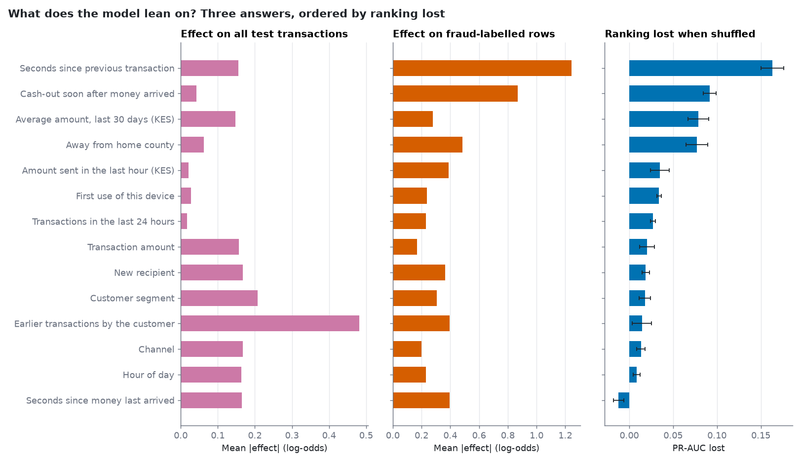
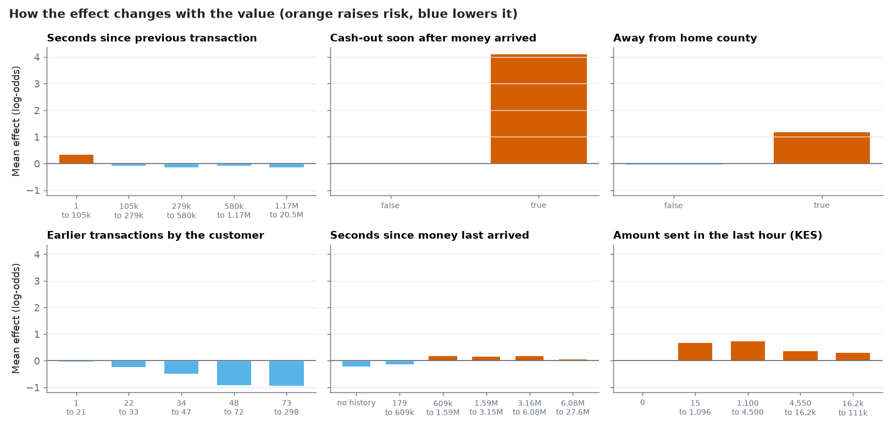
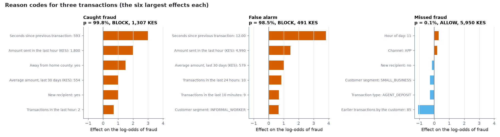

# Model explanations

> **All data is synthetic.** These are explanations of what the model does with its inputs, not of why a transaction is fraudulent: a feature with a large effect is not necessarily a cause, and correlated features share credit. Generated by `python -m mmrisk.models explain`; every number below is computed from the run.

## Key results

- **The explanations are exact for this model.** Each transaction's contributions plus the base value reproduce the model's log-odds to within 2.5e-14 (base value -7.23, a probability of 0.07%). They come from LightGBM's own tree computation (TreeSHAP), not from an approximation.
- **Three measures of importance give different answers.** Averaged over all 24,224 test transactions the largest effects are `n_prior_txns`, `segment`, `channel`; averaged over the 107 fraud-labelled rows they are `secs_since_prev_txn`, `cashout_after_inbound`, `is_away_from_home`; shuffling a feature costs the most ranking quality for `secs_since_prev_txn`, `cashout_after_inbound`, `avg_amount_30d`. Rank correlation with the shuffling measure: +0.26 (all rows) and +0.73 (fraud rows).
  The average over all rows is mostly the variation among ordinary transactions, which the ranking of the few fraud cases hardly depends on; the fraud-row average is closer to what the ranking uses.
- **Stable across time.** The ten largest average effects on the validation and test windows share 10 features over all rows (rank correlation +0.99) and 9 over fraud-labelled rows (rank correlation +0.97, 157 validation and 107 test fraud rows). The all-rows figure is high partly because the same ordinary-row features dominate in every window.
- **Refitting without a feature** (validation PR-AUC 0.537 with all features, 3 seeds): removing `is_away_from_home` (-0.037), `segment` (-0.015) lowers it by more than twice the seed-to-seed spread; removing `avg_amount_30d` (+0.014) raises it by more than twice the spread, so the model is not helped by using that feature on the validation window.
- **Shuffling made the ranking better** for `account_age_days` (-0.008), `secs_since_last_inbound` (-0.012) (by more than 0.005 PR-AUC): the model's use of that feature does not carry over to the test window.
- **Reason codes.** 682 test transactions were flagged (review or block); 100% of them have at least one risk-raising feature to cite. The most common leading reason is `secs_since_prev_txn` (251 flagged transactions).
- **Does it use the signals each fraud pattern is built on?** (uses the hidden truth, see section 5.) For flagged transactions, one of the expected signals is among the top three reasons 100% of the time for LOCATION_JUMP (4 flagged) and 8% for BEHAVIORAL_SHIFT (12 flagged).

## 1. Which features does the model use?

Three measures, because each answers a different question. *Effect on all rows* is the average size of a feature's push on the log-odds over every test transaction. *Effect on fraud-labelled rows* is the same average over the transactions labelled fraud. *Ranking lost when shuffled* is how much PR-AUC falls when that feature's values are shuffled among rows (spread: standard deviation over 8 shuffles; it shows shuffle noise, not the sampling uncertainty of the test window). Amount and its logarithm are judged as one feature.

| Feature | Mean effect, all rows | Mean effect, fraud rows | PR-AUC lost when shuffled | Mean signed effect, all rows |
|---|---|---|---|---|
| `n_prior_txns` | 0.482 | 0.396 | 0.014 | -0.466 |
| `segment` | 0.207 | 0.306 | 0.018 | +0.019 |
| `channel` | 0.168 | 0.198 | 0.013 | -0.017 |
| `is_new_recipient` | 0.168 | 0.365 | 0.019 | -0.053 |
| `secs_since_last_inbound` | 0.165 | 0.394 | -0.012 | +0.065 |
| `hour` | 0.163 | 0.232 | 0.008 | +0.002 |
| `secs_since_prev_txn` | 0.155 | 1.242 | 0.163 | -0.022 |
| `cashout_after_inbound` | 0.042 | 0.868 | 0.092 | -0.000 |
| `is_away_from_home` | 0.063 | 0.484 | 0.077 | -0.004 |
| `amount_sum_1h` | 0.022 | 0.390 | 0.035 | +0.000 |
| `avg_amount_30d` | 0.147 | 0.278 | 0.079 | +0.009 |
| `is_new_device` | 0.028 | 0.236 | 0.034 | -0.019 |

The effects are in log-odds before calibration; multiply by 1.14 (the calibration slope) for the calibrated scale used in reason codes. A feature that matters for the typical row but not for the ranking (a large effect on all rows, a small loss when shuffled) mostly moves ordinary transactions up or down together and does little to separate fraud.

By feature group (all features of a group together; the shuffling column moves the whole group at once, which is the fairer test when features are correlated, such as the velocity counts):

| Group | Share of effect, all rows | Share of effect, fraud rows | PR-AUC lost when the group is shuffled |
|---|---|---|---|
| history | 25% | 24% | 0.162 |
| network | 8% | 18% | 0.153 |
| velocity | 4% | 15% | 0.120 |
| customer | 17% | 13% | 0.099 |
| baseline | 10% | 6% | 0.093 |
| novelty | 8% | 10% | 0.057 |
| transaction | 17% | 7% | 0.029 |
| time | 11% | 7% | 0.025 |

## 2. How does each feature change the score?

Average calibrated effect at each value of the six features with the largest effect on fraud-labelled rows. Orange bars raise the estimated risk, blue bars lower it.

- **Seconds since previous transaction** (`secs_since_prev_txn`): highest average effect at 1 to 104,788 (+0.33, 4,845 rows), lowest at 1,166,842 to 20,452,725 (-0.15, 4,845 rows). Higher values lower the risk on the whole (rank correlation -0.50).
- **Cash-out soon after money arrived** (`cashout_after_inbound`): highest average effect at true (+4.11, 141 rows), lowest at false (-0.02, 24,083 rows).
- **Away from home county** (`is_away_from_home`): highest average effect at true (+1.17, 689 rows), lowest at false (-0.04, 23,535 rows).
- **Earlier transactions by the customer** (`n_prior_txns`): highest average effect at 1 to 21 (-0.04, 4,648 rows), lowest at 73 to 298 (-0.94, 4,903 rows). Higher values lower the risk on the whole (rank correlation -0.87).
- **Seconds since money last arrived** (`secs_since_last_inbound`): highest average effect at 608,872 to 1,591,676 (+0.17, 4,769 rows), lowest at no history (-0.22, 378 rows). Higher values raise the risk on the whole (rank correlation +0.31).
- **Amount sent in the last hour (KES)** (`amount_sum_1h`): highest average effect at 1,100 to 4,500 (+0.73, 145 rows), lowest at 0 (-0.01, 23,650 rows). No steady direction over the whole range (rank correlation +0.25).

## 3. Reason codes for single transactions

The examples are chosen by fixed rules, not for being flattering: the blocked fraud with the highest probability, the blocked legitimate transaction with the highest probability, and the allowed fraud with the largest amount. Effects are on the calibrated log-odds and add up (with the base value) to the transaction's calibrated log-odds.

| Case | Transaction | Probability | Action | Top reasons |
|---|---|---|---|---|
| Caught fraud | TXN000160937 | 99.8% | BLOCK | Seconds since previous transaction: 593 (+3.00); Amount sent in the last hour (KES): 1,800 (+1.99); Away from home county: yes (+1.50) |
| False alarm | TXN000163926 | 98.5% | BLOCK | Seconds since previous transaction: 12.00 (+3.82); Amount sent in the last hour (KES): 4,990 (+1.46); Average amount, last 30 days (KES): 579 (+1.03) |
| Missed fraud | TXN000164777 | 0.1% | ALLOW | none (not flagged) |

How reason codes are produced: for a flagged transaction, the features with the largest positive effect, at most three, each shown as a label and the transaction's own value. They answer "what pushed this score up", not "why is this fraud". For a transaction the model allows, they are not meant to be shown. `RiskModel.explain(df)` returns the same table for any rows (Phase 11 serves it).

Leading reason among flagged test transactions:

| Feature | Flagged transactions |
|---|---|
| `secs_since_prev_txn` | 251 |
| `cashout_after_inbound` | 127 |
| `is_new_recipient` | 66 |
| `amount` | 58 |
| `is_away_from_home` | 45 |
| `is_new_device` | 32 |

## 4. Do the explanations hold up?

**Stability.** The same measure computed on the validation window and on the test window (different months, never used to fit the model). Over all rows the ten largest share 10 features (rank correlation +0.99); over fraud-labelled rows 9 (rank correlation +0.97; 157 validation and 107 test fraud rows, so the fraud-row figure is the noisier of the two).

**Refitting without a feature.** The same settings are refitted with the feature blanked out and scored on the validation window only (the test window plays no part). Baseline: 0.537 PR-AUC (mean of 3 seeds). "Seed spread" is the standard deviation across seeds; a change smaller than about twice that is not distinguishable from refitting noise.

| Feature removed | Validation PR-AUC | Change | Seed spread |
|---|---|---|---|
| `is_away_from_home` | 0.500 | -0.037 | 0.007 |
| `segment` | 0.522 | -0.015 | 0.006 |
| `cashout_after_inbound` | 0.535 | -0.002 | 0.027 |
| `n_prior_txns` | 0.538 | +0.001 | 0.003 |
| `channel` | 0.540 | +0.003 | 0.011 |
| `secs_since_prev_txn` | 0.545 | +0.008 | 0.015 |
| `avg_amount_30d` | 0.551 | +0.014 | 0.006 |

**Shuffling and refitting can disagree.** `secs_since_prev_txn` loses 0.163 PR-AUC when shuffled on the test window, yet refitting without it changed validation PR-AUC by +0.008; `avg_amount_30d` loses 0.079 PR-AUC when shuffled on the test window, yet refitting without it changed validation PR-AUC by +0.014. The fitted model uses these features, but other features carry much of the same information, so it can do without them.

A feature can matter to the fitted model and still be replaceable: when its information is also carried by other features, removing it changes little. That is a reason to treat the importance tables as a description of this fitted model, not as a ranking of causes.

## 5. Audit against ground truth

> **This section uses the hidden ground truth, which a real team would not have.** Nothing here influenced training, tuning, calibration or the decision rule.

For each true fraud pattern, among the test transactions the policy flagged: the features with the largest average effect, and how often at least one of the signals the pattern's description in the data dictionary implies (the author's reading of it, an assumption) is among the three reasons.

| Pattern | Flagged | Leading features | Expected signal in top 3 |
|---|---|---|---|
| BEHAVIORAL_SHIFT | 12 of 19 | `is_new_device`, `secs_since_prev_txn`, `is_away_from_home` | 8% |
| LOCATION_JUMP | 4 of 4 | `secs_since_prev_txn`, `is_away_from_home`, `txn_count_1h` | 100% |
| MULE_CASHOUT | 24 of 25 | `cashout_after_inbound`, `secs_since_last_inbound`, `is_away_from_home` | 100% |
| SIM_SWAP | 18 of 18 | `secs_since_prev_txn`, `is_away_from_home`, `amount_sum_1h` | 50% |
| SOCIAL_ENGINEERING | 7 of 13 | `secs_since_prev_txn`, `is_new_recipient`, `amount_sum_1h` | 71% |
| VELOCITY_BURST | 23 of 30 | `secs_since_prev_txn`, `amount_sum_1h`, `txn_count_24h` | 96% |

Patterns with few rows give noisy percentages; read the counts first.

## 6. Who gets flagged?

The same policy, split by customer attributes available in the data. This is a descriptive check for uneven treatment, not a test of fairness: the segments are synthetic, the labels are the observed (noisy) ones, and the counts are small. "Fraud flagged" is the share of fraud-labelled transactions in the group that were reviewed or blocked (95% interval).

| Attribute | Value | Transactions | Fraud-labelled | Flagged per 10,000 | Legitimate flagged per 10,000 | Fraud flagged |
|---|---|---|---|---|---|---|
| segment | INFORMAL_WORKER | 7,063 | 39 | 307 | 262 | 85% (70% to 93%) |
| segment | SALARIED | 6,324 | 36 | 318 | 280 | 69% (53% to 82%) |
| segment | SMALL_BUSINESS | 8,409 | 17 | 264 | 253 | 59% (36% to 78%) |
| segment | STUDENT | 2,428 | 15 | 173 | 137 | 60% (36% to 80%) |
| channel | APP | 9,420 | 64 | 373 | 329 | 67% (55% to 77%) |
| channel | USSD | 14,804 | 43 | 224 | 201 | 79% (65% to 89%) |
| is_away_from_home | false | 23,535 | 74 | 251 | 233 | 59% (48% to 70%) |
| is_away_from_home | true | 689 | 33 | 1,321 | 884 | 100% (90% to 100%) |
| account_age | 1 year or more | 23,655 | 106 | 282 | 250 | 73% (63% to 80%) |
| account_age | 90 to 364 days | 569 | 1 | 281 | 282 | 0% (0% to 79%) |

Among groups with at least 500 transactions, legitimate transactions are flagged most often in is_away_from_home = true (884 per 10,000) and least often in segment = STUDENT (137 per 10,000). Some difference is expected where the groups really behave differently and the model uses that behaviour (`is_away_from_home` is a model input); whether a difference is acceptable is a business decision this report cannot make.

## What this does not show

- The explanations describe this fitted model on synthetic data. They are not evidence about real fraud or real customers.
- Importance is not causation, and with correlated features the credit is shared in ways that depend on the fitted trees.
- The shuffling and refitting checks use one fitted model and a small number of fraud cases; differences that are small relative to the spread printed next to them should not be read.
- Reason codes are for flagged transactions and explain the score, not the customer's intent. A reason that cites a customer attribute (such as segment) would need review before being shown to a person.
- The slice table is descriptive and uses synthetic segments; it is not a fairness assessment.
